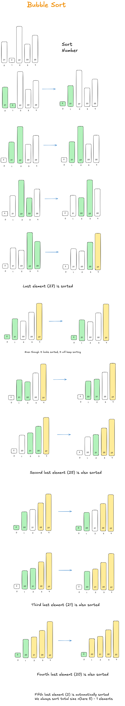

# Bubble Sort

## 1. What is Bubble Sort?

**Bubble Sort** is a simple sorting algorithm that repeatedly compares two adjacent elements and swaps them if they are in the wrong order.

This process continues until the entire collection is sorted.

It is called Bubble Sort because larger elements gradually move toward the end of the array, just like bubbles rising to the surface of water.

### Real-world example: Arranging students by height

Imagine five students standing in a row, but they are not arranged by height.

You want to arrange them from shortest to tallest.

You can do this by:

1. Comparing the first two students.
2. If the first student is taller, swap their positions.
3. Move to the next pair.
4. Continue until you reach the end of the row.
5. Repeat the process until everyone is in the correct order.

After the first complete pass, the tallest student will be at the last position.

After the second pass, the second-tallest student will be at the second-last position.

This is the basic idea behind Bubble Sort.

**The important idea:** Compare adjacent elements and swap them whenever they are in the wrong order.



[Visual Representation](https://visualgo.net/en/sorting)

## 2. How Does Bubble Sort Work?

Consider the following unsorted array:

```java
int[] arr = {5, 3, 8, 4, 2};
```

We want to sort it in ascending order.

That means:

```text
Smallest → Largest
```

Bubble Sort compares adjacent elements from left to right.

### Pass 1

Initial array:

```text
[5, 3, 8, 4, 2]
```

**Comparison 1:** Compare 5 and 3.

Since 5 is greater than 3, swap them.

```text
[3, 5, 8, 4, 2]
```

**Comparison 2:** Compare 5 and 8.

Since 5 is smaller than 8, no swap is required.

```text
[3, 5, 8, 4, 2]
```

**Comparison 3:** Compare 8 and 4.

Since 8 is greater than 4, swap them.

```text
[3, 5, 4, 8, 2]
```

**Comparison 4:** Compare 8 and 2.

Since 8 is greater than 2, swap them.

```text
[3, 5, 4, 2, 8]
```

<escape>```text
After Pass 1:

[3, 5, 4, 2, 8]
             ↑
       Largest element
       is now at the end.
```</escape>

The largest element, 8, has reached its correct position.

### Pass 2

We do not need to compare the last element again because it is already sorted.

Start with:

```text
[3, 5, 4, 2, 8]
```

Compare 3 and 5 → No swap.

```text
[3, 5, 4, 2, 8]
```

Compare 5 and 4 → Swap.

```text
[3, 4, 5, 2, 8]
```

Compare 5 and 2 → Swap.

```text
[3, 4, 2, 5, 8]
```

Now the two largest elements are in their correct positions.

### Pass 3

Start with:

```text
[3, 4, 2, 5, 8]
```

Compare 3 and 4 → No swap.

Compare 4 and 2 → Swap.

```text
[3, 2, 4, 5, 8]
```

The three largest elements are now sorted.

### Pass 4

Start with:

```text
[3, 2, 4, 5, 8]
```

Compare 3 and 2 → Swap.

```text
[2, 3, 4, 5, 8]
```

The array is now sorted.

### Complete pass summary

| Pass | Array after the pass | Sorted elements at the end |
|---|---|---|
| Initial | 5, 3, 8, 4, 2 | None |
| 1 | 3, 5, 4, 2, 8 | 8 |
| 2 | 3, 4, 2, 5, 8 | 5, 8 |
| 3 | 3, 2, 4, 5, 8 | 4, 5, 8 |
| 4 | 2, 3, 4, 5, 8 | 3, 4, 5, 8 |

Final sorted array:

```text
[2, 3, 4, 5, 8]
```

**Observation:** After every complete pass, the largest remaining unsorted element moves to its correct position at the end.

## 3. Bubble Sort Algorithm

### Pseudocode

```text
START

Given an array of n elements

FOR i = 0 TO n - 2:

    FOR j = 0 TO n - i - 2:

        IF arr[j] > arr[j + 1]:

            SWAP arr[j] AND arr[j + 1]

END
```

### Understanding the two loops

**Outer loop (`i`)**

Controls the number of passes.

For an array of `n` elements, at most `n - 1` passes are required.

**Inner loop (`j`)**

Compares adjacent elements and swaps them when necessary.

Why does the inner loop become shorter after every pass?

Because the largest remaining element is already placed at the end.

There is no need to check the sorted portion again.

## 4. Java Implementation

### Approach 1: Basic Bubble Sort

```java
import java.util.Arrays;

public class BubbleSort {

    public static void bubbleSort(int[] arr) {

        int n = arr.length;

        for (int i = 0; i < n - 1; i++) {

            for (int j = 0; j < n - i - 1; j++) {

                if (arr[j] > arr[j + 1]) {

                    // Swap adjacent elements
                    int temp = arr[j];

                    arr[j] = arr[j + 1];

                    arr[j + 1] = temp;
                }
            }
        }
    }

    public static void main(String[] args) {

        int[] arr = {5, 3, 8, 4, 2};

        bubbleSort(arr);

        System.out.println(Arrays.toString(arr));
    }
}
```

**Output:**

```text
[2, 3, 4, 5, 8]
```

### Understanding the swap operation

Consider:

```java
int a = 5;
int b = 3;
```

We want to exchange their values.

Incorrect approach:

```java
a = b;
b = a;
```

Both variables will contain `3`, because the original value of `a` is lost.

Correct approach:

```java
int temp = a;

a = b;

b = temp;
```

Now:

```text
a = 3
b = 5
```

The temporary variable preserves the original value.

## 5. Optimized Bubble Sort

The basic Bubble Sort always performs all `n - 1` passes, even if the array becomes sorted earlier.

Can we make it smarter?

Yes!

Imagine the array is already sorted:

```java
int[] arr = {1, 2, 3, 4, 5};
```

During the first pass, every adjacent pair is already in the correct order.

No swaps are required.

There is no reason to continue with the remaining passes.

We can introduce a boolean variable called `swapped`.

- Initially, set `swapped = false`.
- Whenever two elements are exchanged, set it to `true`.
- After a complete pass, if `swapped` is still `false`, the array is already sorted.
- Stop the algorithm.

### Java implementation

```java
import java.util.Arrays;

public class OptimizedBubbleSort {

    public static void bubbleSort(int[] arr) {

        int n = arr.length;

        for (int i = 0; i < n - 1; i++) {

            boolean swapped = false;

            for (int j = 0; j < n - i - 1; j++) {

                if (arr[j] > arr[j + 1]) {

                    int temp = arr[j];

                    arr[j] = arr[j + 1];

                    arr[j + 1] = temp;

                    swapped = true;
                }
            }

            // No swaps means the array is sorted
            if (!swapped) {
                break;
            }
        }
    }

    public static void main(String[] args) {

        int[] arr = {1, 2, 3, 4, 5};

        bubbleSort(arr);

        System.out.println(Arrays.toString(arr));
    }
}
```

**Output:**

```text
[1, 2, 3, 4, 5]
```

The algorithm finishes after just one pass.

**Important:** The optimized version improves the best-case time complexity from O(n²) to O(n). The average and worst-case time complexities remain O(n²).

## 6. Time Complexity of Bubble Sort

Bubble Sort uses two nested loops.

The number of comparisons depends on the number of elements.

For an array of `n` elements:

| Pass | Comparisons |
|---|---:|
| 1 | n - 1 |
| 2 | n - 2 |
| 3 | n - 3 |
| 4 | n - 4 |
| ... | ... |
| Last | 1 |

Total comparisons:

\[
(n-1)+(n-2)+\cdots+1
\]

Using the sum of the first `n - 1` natural numbers:

\[
\frac{n(n-1)}{2}
\]

Therefore:

\[
\boxed{O(n^2)}
\]

### Best Case — O(n)

This applies to the optimized Bubble Sort.

When the array is already sorted:

```text
[1, 2, 3, 4, 5]
```

Only one pass is required to verify that no swaps are needed.

Comparisons:

\[
n-1
\]

Time Complexity:

\[
\boxed{O(n)}
\]

### Average Case — O(n²)

When the elements are in a random order, Bubble Sort generally requires multiple passes and many comparisons.

Time Complexity:

\[
\boxed{O(n^2)}
\]

### Worst Case — O(n²)

The worst case occurs when the array is sorted in reverse order.

Example:

```text
[5, 4, 3, 2, 1]
```

Almost every adjacent comparison requires a swap.

The algorithm performs:

\[
\frac{n(n-1)}{2}
\]

comparisons and the same number of swaps in this reverse-sorted example.

Time Complexity:

\[
\boxed{O(n^2)}
\]

### Complexity summary

| Case | Basic Bubble Sort | Optimized Bubble Sort |
|---|---|---|
| Best | O(n²) | O(n) |
| Average | O(n²) | O(n²) |
| Worst | O(n²) | O(n²) |

## 7. Space Complexity

Bubble Sort sorts the original array without creating another array.

It uses only a few additional variables:

- `i` — outer loop counter.
- `j` — inner loop counter.
- `temp` — temporary variable for swapping.
- `swapped` — optimization flag.

Therefore:

**Auxiliary Space Complexity: O(1)**

It is an in-place sorting algorithm.

## 8. Important Properties of Bubble Sort

### A. In-place Sorting

Bubble Sort modifies the original array directly.

It does not require another array proportional to the input size.

Auxiliary Space: O(1).

### B. Stable Sorting

Bubble Sort is stable when it swaps elements only when the left element is strictly greater than the right element.

Consider:

```text
[(A, 5), (B, 3), (C, 5)]
```

Here, A and C have the same sorting value of 5.

After sorting:

```text
[(B, 3), (A, 5), (C, 5)]
```

The relative order of A and C is preserved.

**Why?**

Because equal elements are not swapped.

If the comparison uses `>=` instead of `>`, equal elements may be swapped, and stability is no longer guaranteed.

### C. Adaptive Sorting

The optimized Bubble Sort is adaptive.

It performs better when the input is already sorted or nearly sorted.

The basic version without the `swapped` flag is not adaptive in the same way because it continues all passes.

### D. Comparison-Based Sorting

Bubble Sort sorts elements by comparing pairs of values.

It belongs to the comparison-based sorting family.

## 9. Sorting in Descending Order

So far, we have sorted elements in ascending order.

What if we want descending order?

We only need to change the comparison condition.

Ascending:

```java
if (arr[j] > arr[j + 1])
```

Descending:

```java
if (arr[j] < arr[j + 1])
```

### Java implementation

```java
public static void bubbleSortDescending(int[] arr) {

    int n = arr.length;

    for (int i = 0; i < n - 1; i++) {

        boolean swapped = false;

        for (int j = 0; j < n - i - 1; j++) {

            if (arr[j] < arr[j + 1]) {

                int temp = arr[j];

                arr[j] = arr[j + 1];

                arr[j + 1] = temp;

                swapped = true;
            }
        }

        if (!swapped) {
            break;
        }
    }
}
```

Example:

```text
Input:  [5, 3, 8, 4, 2]

Output: [8, 5, 4, 3, 2]
```

## 10. Bubble Sort with Strings

Bubble Sort can also sort Strings.

For Strings, we use `compareTo()` instead of the `>` operator.

```java
import java.util.Arrays;

public class StringBubbleSort {

    public static void bubbleSort(String[] arr) {

        int n = arr.length;

        for (int i = 0; i < n - 1; i++) {

            boolean swapped = false;

            for (int j = 0; j < n - i - 1; j++) {

                if (arr[j].compareTo(arr[j + 1]) > 0) {

                    String temp = arr[j];

                    arr[j] = arr[j + 1];

                    arr[j + 1] = temp;

                    swapped = true;
                }
            }

            if (!swapped) {
                break;
            }
        }
    }

    public static void main(String[] args) {

        String[] names = {"Rahul", "Aman", "Sara", "Priya"};

        bubbleSort(names);

        System.out.println(Arrays.toString(names));
    }
}
```

Output:

```text
[Aman, Priya, Rahul, Sara]
```

`compareTo()` returns:

- A negative value when the first String comes before the second.
- Zero when they are equal.
- A positive value when the first String comes after the second.

The comparison follows Java's lexicographical String ordering, which is case-sensitive.

## 11. Bubble Sort vs Other Sorting Algorithms

| Algorithm | Best Case | Average Case | Worst Case | Auxiliary Space | Stable? |
|---|---|---|---|---|---|
| Bubble Sort (optimized) | O(n) | O(n²) | O(n²) | O(1) | Yes |
| Selection Sort | O(n²) | O(n²) | O(n²) | O(1) | No* |
| Insertion Sort | O(n) | O(n²) | O(n²) | O(1) | Yes |
| Merge Sort | O(n log n) | O(n log n) | O(n log n) | O(n) | Yes |
| Quick Sort | O(n log n) | O(n log n) | O(n²) | O(log n) average stack | Usually no |
| Heap Sort | O(n log n) | O(n log n) | O(n log n) | O(1) | No |

*Standard Selection Sort is not stable, though stable variants exist.*

### When should you use Bubble Sort?

Bubble Sort is useful for:

1. Learning how sorting algorithms work.
2. Understanding comparisons and swapping.
3. Teaching nested loops and algorithm complexity.
4. Very small datasets where simplicity matters.
5. Demonstrating how an optimized algorithm can detect already-sorted input.

**In production applications, Bubble Sort is rarely the best choice.** Java provides optimized sorting implementations that are generally much faster.

## 12. Common Mistakes

### Mistake 1: Incorrect inner loop boundary

Incorrect:

```java
for (int j = 0; j < n - i; j++) {
    if (arr[j] > arr[j + 1]) {
        // swap
    }
}
```

This can access `arr[n]`, which is outside the array.

Correct:

```java
for (int j = 0; j < n - i - 1; j++) {
    if (arr[j] > arr[j + 1]) {
        // swap
    }
}
```

### Mistake 2: Forgetting the swap flag

Incorrect:

```java
boolean swapped = false;

if (arr[j] > arr[j + 1]) {
    // swap
}

if (!swapped) {
    break;
}
```

The flag is never updated.

Correct:

```java
if (arr[j] > arr[j + 1]) {

    int temp = arr[j];
    arr[j] = arr[j + 1];
    arr[j + 1] = temp;

    swapped = true;
}
```

### Mistake 3: Resetting the flag in the wrong place

Incorrect:

```java
for (int i = 0; i < n - 1; i++) {

    for (int j = 0; j < n - i - 1; j++) {

        boolean swapped = false;
    }
}
```

The flag must be initialized once per outer pass, not once per comparison.

Correct:

```java
for (int i = 0; i < n - 1; i++) {

    boolean swapped = false;

    for (int j = 0; j < n - i - 1; j++) {
        // comparisons and swaps
    }
}
```

### Mistake 4: Swapping when elements are equal

Using:

```java
if (arr[j] >= arr[j + 1])
```

may swap equal elements and break stability.

Use:

```java
if (arr[j] > arr[j + 1])
```

for stable ascending Bubble Sort.

## 13. Real-World Applications

Bubble Sort itself is rarely used in large production systems, but its underlying ideas are useful for understanding sorting.

Examples:

1. **Learning algorithm fundamentals:** Understanding how comparisons and swaps arrange data.
2. **Small collections:** Sorting a very small collection where implementation simplicity is more important than performance.
3. **Educational visualization:** Demonstrating how adjacent elements move toward their correct positions.
4. **Nearly sorted data:** The optimized version can finish in O(n) when the array is already sorted.
5. **Understanding stable sorting:** Learning why equal elements should retain their original relative order.

## 14. Interview Questions and Answers

### Q1. What is Bubble Sort?

Bubble Sort is a comparison-based sorting algorithm that repeatedly compares adjacent elements and swaps them if they are in the wrong order.

### Q2. Why is it called Bubble Sort?

Because larger elements gradually move toward the end of the array after every pass, similar to bubbles rising to the surface.

### Q3. What is the time complexity of Bubble Sort?

- Best Case: O(n) with optimization.
- Average Case: O(n²).
- Worst Case: O(n²).

Without the early-exit optimization, even the best case is O(n²).

### Q4. What is the space complexity of Bubble Sort?

O(1), because it sorts the original array and uses only a constant amount of additional memory.

### Q5. Is Bubble Sort stable?

Yes, if equal elements are not swapped. The standard implementation uses `>` rather than `>=`.

### Q6. Is Bubble Sort in-place?

Yes. It modifies the original array without creating another array proportional to its size.

### Q7. What is the maximum number of passes required?

For an array containing `n` elements, at most `n - 1` passes are required.

### Q8. Why does the inner loop become shorter after every pass?

Because the largest remaining element is placed at the end after each complete pass. Those positions no longer need to be checked.

### Q9. How can Bubble Sort be optimized?

Use a boolean `swapped` variable. If no swaps occur during a complete pass, the array is already sorted, so stop.

### Q10. Which sorting algorithm is better: Bubble Sort or Insertion Sort?

Both have O(n²) average and worst-case time complexity.

Insertion Sort is generally more practical because it often performs fewer operations and works efficiently on small or nearly sorted datasets.

### Q11. Can Bubble Sort sort Strings?

Yes. Use `compareTo()` to compare adjacent Strings.

### Q12. Is Bubble Sort a comparison-based algorithm?

Yes. It compares adjacent elements to determine whether they need to be exchanged.

### Q13. What is the number of comparisons in standard Bubble Sort?

For an array of `n` elements:

\[
\frac{n(n-1)}{2}
\]

### Q14. Does Bubble Sort perform well on an already sorted array?

The optimized implementation performs one pass and finishes in O(n). The basic implementation still performs all passes.

### Q15. Why is Bubble Sort not preferred for large datasets?

Its average and worst-case time complexity is O(n²), so the number of operations increases rapidly as the input size grows.

## 15. Practice Problems

Try implementing these problems using Bubble Sort.

### Beginner

1. Sort an integer array in ascending order.
2. Sort an integer array in descending order.
3. Implement optimized Bubble Sort.
4. Count the total number of comparisons.
5. Count the total number of swaps.
6. Check whether an array is already sorted.

### Intermediate

7. Sort an array of Strings alphabetically.
8. Sort only the first `k` elements of an array.
9. Sort an array containing positive and negative numbers.
10. Find the number of passes required to sort an array.
11. Implement Bubble Sort without using a temporary variable (consider the risks of arithmetic swapping and integer overflow).
12. Demonstrate that your implementation is stable using objects with duplicate sorting keys.

### Challenge

13. Implement a generic Bubble Sort using Java's `Comparator`.
14. Sort an array of student objects by marks.
15. Sort an array of employee objects by salary.
16. Compare Bubble Sort and Insertion Sort on already sorted and reverse-sorted arrays.
17. Measure and compare the number of swaps performed by both algorithms.

## 16. Quick Revision

| Concept | Answer |
|---|---|
| Algorithm type | Sorting |
| Sorting approach | Adjacent comparison and swapping |
| Best Case | O(n) optimized |
| Average Case | O(n²) |
| Worst Case | O(n²) |
| Auxiliary Space | O(1) |
| In-place? | Yes |
| Stable? | Yes, with strict comparison |
| Adaptive? | Optimized version |
| Maximum passes | n - 1 |
| Comparison condition (ascending) | `arr[j] > arr[j + 1]` |
| Comparison condition (descending) | `arr[j] < arr[j + 1]` |
| Early termination | `swapped == false` |

## Final Takeaway

Bubble Sort teaches an important lesson in algorithm design: **a correct solution is not necessarily an efficient solution.**

It is easy to understand because it repeatedly compares neighboring elements and moves larger values toward the end.

Although it is rarely used for large production datasets, learning Bubble Sort helps build a strong foundation for understanding Insertion Sort, Selection Sort, Merge Sort, Quick Sort, and other sorting algorithms.

Remember these three things:

1. Compare adjacent elements.
2. Swap them if they are in the wrong order.
3. After each pass, the largest remaining element reaches its correct position.

Once you understand these ideas, Bubble Sort becomes very easy to implement and explain in an interview.