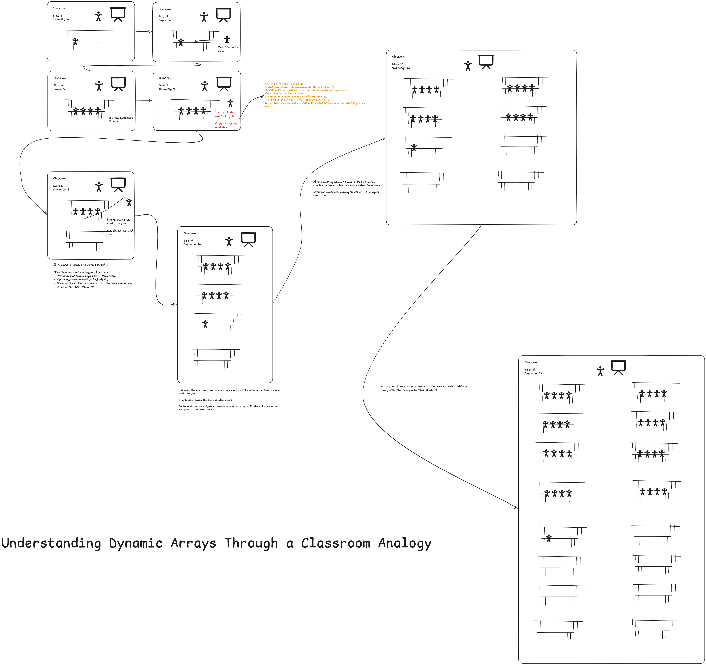

# Dynamic Arrays / ArrayList

## 1. Introduction

An **Array** is a data structure that stores multiple elements of the same type in a continuous block of memory.

For example:

```java
int[] numbers = {10, 20, 30, 40, 50};
```

We can access any element directly using its index.

```java
System.out.println(numbers[2]); // 30
```

However, a normal Java Array has a fixed size.

```java
int[] numbers = new int[5];
```

This Array can store only five elements. If we want to store a sixth element, we cannot increase its size directly.

But think about these situations:

- A teacher starts a class with 20 students, but 5 more students join later.
- A scientist collects an unknown number of interesting stones during an experiment.
- A treasure hunter discovers more and more objects and wants to keep them in order.
- A school collects applications, but nobody knows how many students will apply.

How can we store these elements if we don't know the total number in advance?

Creating a new Array every time we need more space would be inconvenient.

This is where a **Dynamic Array** becomes useful.

A Dynamic Array is an array-based data structure that automatically adjusts its capacity when more elements need to be stored.

In Java, the most commonly used Dynamic Array implementation is **ArrayList**.

---

## 2. Real-Life Examples of Dynamic Arrays

### Example 1: A Classroom That Keeps Growing

Imagine a teacher preparing a list of students before the new school year.

Initially, the teacher expects only four students:

```text
Students:

[Ali] [Sara] [John] [Ayesha]
```

But more students join:

```text
[Ali] [Sara] [John] [Ayesha] [David] [Mary]
```

The teacher does not know exactly how many students will join.

Instead of preparing a completely new list manually every time, imagine having a list that can grow whenever required.

This is the main idea behind a Dynamic Array.

**Think about it:** If the teacher has space for only four students, what should happen when the fifth student arrives?

A Dynamic Array solves this problem by creating a larger internal Array and moving the existing elements into it.



### Example 2: A Treasure Collector

Imagine you are exploring a playground and collecting interesting objects.

You find:

```text
Stone, Shell, Coin
```

You keep them in an ordered collection.

Suddenly, you discover more objects:

```text
Stone, Shell, Coin, Feather, Marble, Key
```

You didn't know how many objects you would find at the beginning.

A Dynamic Array is useful because it can grow as your collection grows.

### Example 3: A Science Experiment

Imagine a group of children observing insects in a garden.

They record each different type of insect they discover.

Initially:

```text
Ant, Butterfly
```

After some time:

```text
Ant, Butterfly, Bee, Ladybug, Dragonfly
```

They cannot predict the final number of discoveries.

A Dynamic Array allows them to keep adding observations without deciding the final size beforehand.

### Example 4: School Admission Applications

A school opens admissions and starts collecting applications.

The school expects around 100 applications, but receives 500.

The application collection needs to grow as new applications arrive.

A Dynamic Array can handle this automatically.

---

## 3. Static Array vs Dynamic Array

Let's understand the difference.

### 3.1 Static Array

A normal Java Array has a fixed length.

```java
int[] numbers = new int[3];

numbers[0] = 10;
numbers[1] = 20;
numbers[2] = 30;
```

Representation:

```text
Index:    0      1      2
       +------+------+------+
Array: |  10  |  20  |  30  |
       +------+------+------+

Capacity = 3
Size     = 3
```

What happens if we try to insert another element?

```java
numbers[3] = 40;
```

Output:

```text
ArrayIndexOutOfBoundsException
```

The Array cannot grow automatically.

### 3.2 Dynamic Array

A Dynamic Array can grow when more elements are inserted.

Imagine its internal capacity is initially 3.

```text
Index:    0      1      2
       +------+------+------+
Array: |  10  |  20  |  30  |
       +------+------+------+

Size     = 3
Capacity = 3
```

Now we want to insert `40`.

There is no empty position available.

The Dynamic Array creates a larger internal Array and copies the existing elements.

```text
Old Array:

[10] [20] [30]

       |
       | Resize
       v

New Array:

[10] [20] [30] [40] [ ] [ ]
```

Now it has enough space for more elements.

```text
Size     = 4
Capacity = 6
```

The important point is that the Dynamic Array does not increase the size of the original Array. It creates a new, larger Array and moves the elements into it.

---

## 4. Important Terms: Size vs Capacity

These two terms are very important.

**Size:** The number of elements currently stored.

**Capacity:** The total number of elements that can be stored in the currently allocated internal Array without resizing.

Example:

```text
Internal Array:

+------+------+------+------+------+------+
|  10  |  20  |  30  |  40  |      |      |
+------+------+------+------+------+------+

Size     = 4
Capacity = 6
```

Here:

- Four positions contain elements.
- Two positions are available for future elements.

Remember:

```text
Size <= Capacity
```

Size and capacity are not always equal.

In Java:

```java
ArrayList<Integer> numbers = new ArrayList<>();

numbers.add(10);
numbers.add(20);
numbers.add(30);

System.out.println(numbers.size()); // 3
```

The `size()` method returns the number of stored elements.

Java's `ArrayList` does not provide a public `capacity()` method. Its internal capacity is an implementation detail.

---

## 5. How Does a Dynamic Array Work Internally?

Let's understand the resizing process step by step.

For learning purposes, imagine a Dynamic Array that starts with a capacity of 2 and doubles its capacity whenever it becomes full.

This is a simplified example to explain the concept. Java's actual `ArrayList` growth policy is different.

### Step 1: Create an empty Dynamic Array

```text
Capacity = 2
Size     = 0

+------+------+ 
|      |      |
+------+------+
```

### Step 2: Insert the first element

Insert `10`.

```text
Capacity = 2
Size     = 1

+------+------+
|  10  |      |
+------+------+
```

### Step 3: Insert the second element

Insert `20`.

```text
Capacity = 2
Size     = 2

+------+------+
|  10  |  20  |
+------+------+
```

The Array is now full.

### Step 4: Insert the third element

We want to insert `30`, but there is no available position.

The Dynamic Array creates a new Array with double the capacity.

```text
Old Array:

+------+------+
|  10  |  20  |
+------+------+

New Array:

+------+------+------+------+
|  10  |  20  |      |      |
+------+------+------+------+
```

The existing elements are copied into the new Array.

Now insert `30`.

```text
Capacity = 4
Size     = 3

+------+------+------+------+
|  10  |  20  |  30  |      |
+------+------+------+------+
```

### Step 5: Insert the fourth element

Insert `40`.

```text
Capacity = 4
Size     = 4

+------+------+------+------+
|  10  |  20  |  30  |  40  |
+------+------+------+------+
```

The Array is full again.

### Step 6: Insert the fifth element

Insert `50`.

The Dynamic Array creates a new Array with capacity 8.

```text
Old Array:

[10] [20] [30] [40]

New Array:

[10] [20] [30] [40] [50] [ ] [ ] [ ]
```

Now:

```text
Size     = 5
Capacity = 8
```

### Complete Growth Example

```text
Insert 10:
[10] [ ]
Capacity = 2

Insert 20:
[10] [20]
Capacity = 2

Insert 30:
[10] [20] [30] [ ]
Capacity = 4

Insert 40:
[10] [20] [30] [40]
Capacity = 4

Insert 50:
[10] [20] [30] [40] [50] [ ] [ ] [ ]
Capacity = 8
```

**Important:** Resizing requires allocating a new Array and copying existing elements. Therefore, a single insertion that triggers resizing can take `O(n)` time.

However, adding elements repeatedly is still `O(1)` on average, or **amortized O(1)**.

We will understand this complexity later.

---

## 6. Implementing a Dynamic Array in Java

Let's create our own Dynamic Array instead of using Java's built-in `ArrayList`.

This will help us understand how ArrayList works internally.

### 6.1 Create a Dynamic Array Class

Our implementation will support:

- Add an element.
- Get an element by index.
- Update an element.
- Remove an element.
- Search for an element.
- Get the current size.
- Check whether the collection is empty.
- Display all elements.
- Resize the internal Array when required.

```java
import java.util.Arrays;

class DynamicArray {

    private int[] data;
    private int size;

    public DynamicArray() {

        data = new int[2];
        size = 0;
    }

    // Add an element at the end
    public void add(int value) {

        if (size == data.length) {
            resize();
        }

        data[size] = value;
        size++;
    }

    // Increase capacity
    private void resize() {

        int newCapacity = data.length * 2;

        int[] newArray = new int[newCapacity];

        for (int i = 0; i < size; i++) {
            newArray[i] = data[i];
        }

        data = newArray;
    }

    // Get an element by index
    public int get(int index) {

        checkIndex(index);

        return data[index];
    }

    // Update an element
    public void set(int index, int value) {

        checkIndex(index);

        data[index] = value;
    }

    // Remove the last element
    public int removeLast() {

        if (size == 0) {
            throw new IllegalStateException("Array is empty");
        }

        int removed = data[size - 1];

        data[size - 1] = 0;
        size--;

        return removed;
    }

    // Search for an element
    public boolean contains(int value) {

        for (int i = 0; i < size; i++) {

            if (data[i] == value) {
                return true;
            }
        }

        return false;
    }

    // Get current size
    public int size() {
        return size;
    }

    // Get current capacity
    public int capacity() {
        return data.length;
    }

    // Check whether empty
    public boolean isEmpty() {
        return size == 0;
    }

    // Validate index
    private void checkIndex(int index) {

        if (index < 0 || index >= size) {
            throw new IndexOutOfBoundsException();
        }
    }

    // Display elements
    public void display() {

        for (int i = 0; i < size; i++) {
            System.out.print(data[i] + " ");
        }

        System.out.println();
    }
}
```

### 6.2 Test Our Dynamic Array

```java
public class Main {

    public static void main(String[] args) {

        DynamicArray numbers = new DynamicArray();

        numbers.add(10);
        numbers.add(20);

        System.out.println("Size: " + numbers.size());
        System.out.println("Capacity: " + numbers.capacity());

        // This insertion triggers resizing
        numbers.add(30);

        System.out.println("After resizing:");

        numbers.display();

        System.out.println("Size: " + numbers.size());
        System.out.println("Capacity: " + numbers.capacity());

        numbers.add(40);
        numbers.add(50);

        numbers.display();

        System.out.println("Element at index 2: "
                + numbers.get(2));

        System.out.println("Contains 40: "
                + numbers.contains(40));

        numbers.removeLast();

        System.out.println("After removing last element:");

        numbers.display();
    }
}
```

Output:

```text
Size: 2
Capacity: 2

After resizing:
10 20 30

Size: 3
Capacity: 4

10 20 30 40 50

Element at index 2: 30
Contains 40: true

After removing last element:
10 20 30 40
```

This is a simple Dynamic Array implementation.

For simplicity, it doubles its capacity and does not shrink its internal Array when elements are removed.

---

## 7. ArrayList in Java

Java provides a built-in Dynamic Array implementation called `ArrayList`.

It belongs to the Java Collection Framework and is available in the `java.util` package.

```java
import java.util.ArrayList;
```

Example:

```java
import java.util.ArrayList;

public class Main {

    public static void main(String[] args) {

        ArrayList<Integer> numbers = new ArrayList<>();

        numbers.add(10);
        numbers.add(20);
        numbers.add(30);

        System.out.println(numbers);
    }
}
```

Output:

```text
[10, 20, 30]
```

Unlike a normal Array, we do not need to specify a fixed size.

The ArrayList grows automatically when more elements are added.

### 7.1 ArrayList with Different Data Types

ArrayList stores objects, so we use wrapper classes for primitive types.

| Primitive Type | Wrapper Class |
|---|---|
| `int` | `Integer` |
| `double` | `Double` |
| `float` | `Float` |
| `long` | `Long` |
| `char` | `Character` |
| `boolean` | `Boolean` |

Examples:

```java
ArrayList<Integer> numbers = new ArrayList<>();

ArrayList<String> names = new ArrayList<>();

ArrayList<Double> prices = new ArrayList<>();

ArrayList<Boolean> results = new ArrayList<>();
```

Java automatically converts primitive values into their corresponding wrapper objects through autoboxing.

For example:

```java
ArrayList<Integer> numbers = new ArrayList<>();

numbers.add(10); // int is autoboxed to Integer
```

---

## 8. Important ArrayList Operations

### 8.1 Add Elements

```java
ArrayList<Integer> numbers = new ArrayList<>();

numbers.add(10);
numbers.add(20);
numbers.add(30);

System.out.println(numbers);
```

Output:

```text
[10, 20, 30]
```

`add(element)` adds the element at the end.

### 8.2 Add at a Specific Index

```java
ArrayList<Integer> numbers = new ArrayList<>();

numbers.add(10);
numbers.add(20);
numbers.add(30);

numbers.add(1, 15);

System.out.println(numbers);
```

Output:

```text
[10, 15, 20, 30]
```

The existing elements from that position are shifted to the right.

### 8.3 Access an Element

```java
System.out.println(numbers.get(2));
```

Output:

```text
20
```

ArrayList supports direct indexed access.

Time Complexity: `O(1)`.

### 8.4 Update an Element

```java
numbers.set(1, 100);
```

Before:

```text
[10, 15, 20, 30]
```

After:

```text
[10, 100, 20, 30]
```

Time Complexity: `O(1)`.

### 8.5 Remove an Element by Index

```java
numbers.remove(1);
```

Before:

```text
[10, 100, 20, 30]
```

After:

```text
[10, 20, 30]
```

The elements after the removed index shift one position to the left.

Time Complexity: `O(n)`.

### 8.6 Remove an Element by Value

```java
numbers.remove(Integer.valueOf(20));
```

This removes the first matching value.

Important: When working with `ArrayList<Integer>`, `remove(1)` removes the element at index `1`, not the Integer value `1`.

To remove the value `1`, use:

```java
numbers.remove(Integer.valueOf(1));
```

### 8.7 Find the Size

```java
System.out.println(numbers.size());
```

Returns the number of elements currently stored.

Time Complexity: `O(1)`.

### 8.8 Check Whether an Element Exists

```java
System.out.println(numbers.contains(20));
```

Returns `true` if the element exists.

Time Complexity: `O(n)`.

### 8.9 Check Whether the List Is Empty

```java
System.out.println(numbers.isEmpty());
```

Returns `true` if there are no elements.

### 8.10 Remove All Elements

```java
numbers.clear();
```

Removes all elements from the ArrayList.

The size becomes zero.

### 8.11 Get the Index of an Element

```java
numbers.indexOf(30);
```

Returns the index of the first occurrence, or `-1` if the element is not found.

### 8.12 Iterate Through an ArrayList

Using a normal for loop:

```java
for (int i = 0; i < numbers.size(); i++) {

    System.out.println(numbers.get(i));
}
```

Using an enhanced for loop:

```java
for (Integer number : numbers) {

    System.out.println(number);
}
```

Using forEach:

```java
numbers.forEach(System.out::println);
```

---

## 9. ArrayList Internal Working

How does Java's ArrayList grow automatically?

Internally, ArrayList uses an ordinary Array to store its elements.

It maintains two important concepts:

1. Size: Number of elements currently stored.
2. Capacity: Length of the internal Array.

When the internal Array becomes full, ArrayList creates a larger Array and copies the existing elements.

### Example

```java
ArrayList<Integer> numbers = new ArrayList<>();

numbers.add(10);
numbers.add(20);
numbers.add(30);
```

Conceptually:

```text
ArrayList:

Size = 3

Internal Array:
[10] [20] [30] [ ] ...
```

The actual internal capacity depends on how the ArrayList was constructed and how it has grown.

### What Happens When Capacity Is Full?

Suppose the internal Array is full.

```text
[10] [20] [30] [40]
```

Now we add `50`.

ArrayList must:

1. Check whether there is enough capacity.
2. Allocate a larger internal Array.
3. Copy the existing elements.
4. Store the new element.
5. Use the new Array internally.

Conceptually:

```text
Old Array:

[10] [20] [30] [40]

          |
          | Resize
          v

New Array:

[10] [20] [30] [40] [50] [ ] ...
```

**Important Java detail:** In commonly used modern OpenJDK implementations, ArrayList typically grows by approximately 50% when it needs more capacity. This is an implementation detail, not a guaranteed Java API contract.

For example, an internal capacity of 10 may grow to approximately 15 when more space is needed.

Do not assume that every Java implementation or future version must use exactly the same growth factor.

---

## 10. Initial Capacity in ArrayList

By default:

```java
ArrayList<Integer> numbers = new ArrayList<>();
```

The ArrayList starts empty. In commonly used OpenJDK implementations, the default empty list uses a shared empty backing array and allocates storage when the first element is inserted.

We can also specify an initial capacity.

```java
ArrayList<Integer> numbers = new ArrayList<>(100);
```

This requests an initial capacity of 100.

It does not mean the list already contains 100 elements.

```java
System.out.println(numbers.size()); // 0
```

Why specify initial capacity?

Imagine we know that an application will store around 10,000 records.

We can create:

```java
ArrayList<Integer> numbers = new ArrayList<>(10000);
```

This can reduce the number of resizing operations while elements are added.

However, the list size remains zero until elements are actually inserted.

### Important Difference

```java
ArrayList<Integer> list1 = new ArrayList<>(100);
```

This creates an empty list with requested initial capacity 100.

But:

```java
ArrayList<Integer> list2 =
        new ArrayList<>(Collections.nCopies(100, 0));
```

This creates a list containing 100 elements, each initialized to zero.

Capacity and size are different concepts.

---

## 11. Time Complexity of ArrayList

| Operation | Time Complexity | Explanation |
|---|---|---|
| Get by index | O(1) | Direct index access |
| Set by index | O(1) | Direct index update |
| Add at end | Amortized O(1) | Usually inserts at next available position |
| Add at end with resize | O(n) | Must copy existing elements |
| Add at specific index | O(n) | May shift existing elements |
| Remove by index | O(n) | May shift remaining elements |
| Remove by value | O(n) | Search and shift |
| Search / Contains | O(n) | Linear search |
| IndexOf | O(n) | Linear search |
| Size | O(1) | Stored size value |
| IsEmpty | O(1) | Checks size |
| Clear | O(n) | Clears references in the backing Array |

### Why Is Get O(1)?

Because ArrayList uses an Array internally.

For example:

```java
numbers.get(3);
```

The element at index `3` can be accessed directly.

### Why Is Add at End Amortized O(1)?

Most insertions simply place the element in the next available position.

However, occasionally the internal Array becomes full and needs resizing.

That particular insertion takes `O(n)` time because existing elements must be copied.

But resizing does not happen on every insertion.

When we consider a long sequence of insertions, the average cost per insertion remains constant.

This is called **Amortized O(1)**.

### Why Is Insertion in the Middle O(n)?

Consider:

```text
[10] [20] [30] [40] [ ]
```

We want to insert `25` at index 2.

The existing elements must shift right:

```text
[10] [20] [25] [30] [40]
```

Therefore, insertion in the middle takes O(n) time.

---

## 12. ArrayList vs LinkedList

Both ArrayList and LinkedList implement the Java `List` interface, but their internal structures are different.

| Feature | ArrayList | LinkedList |
|---|---|---|
| Internal structure | Dynamic Array | Doubly Linked List |
| Memory | Backing Array | Individual nodes |
| Access by index | O(1) | O(n) |
| Search | O(n) | O(n) |
| Add at end | Amortized O(1) | O(1) |
| Insert at beginning | O(n) | O(1) |
| Remove at beginning | O(n) | O(1) |
| Remove at end | O(n) | O(1) |
| Memory overhead | Lower | Higher |
| Cache locality | Usually better | Usually poorer |

### Example: Accessing the 100th Element

With ArrayList:

```java
list.get(99);
```

Direct access takes O(1).

With LinkedList:

The implementation must traverse nodes to reach the required position.

This takes O(n) time in the worst case.

### Example: Inserting at the Beginning

ArrayList:

```text
Before:
[10] [20] [30] [40]

Insert 5:

[5] [10] [20] [30] [40]
```

Existing elements must shift right.

LinkedList:

```text
Before:
10 <-> 20 <-> 30 <-> 40

Insert 5:

5 <-> 10 <-> 20 <-> 30 <-> 40
```

Only references need to be updated.

### Which One Should We Use?

Use ArrayList when:

- You frequently access elements by index.
- You mostly add elements at the end.
- You need a general-purpose list.
- You want good memory efficiency and cache locality.

Use LinkedList when:

- You need efficient operations at both ends.
- You are working with a Deque.
- You already have a reference to the node that needs to be removed or modified in a custom linked-list implementation.

For most general-purpose Java List use cases, **ArrayList is the preferred starting choice**.

---

## 13. ArrayList vs Array

| Feature | Array | ArrayList |
|---|---|---|
| Size | Fixed | Dynamic |
| Can grow automatically | No | Yes |
| Can store primitives directly | Yes | No, uses wrapper types |
| Indexed access | O(1) | O(1) |
| Built-in methods | Limited | Many |
| Memory overhead | Usually lower | Additional object and capacity overhead |
| Type | Language feature | Java Collection Framework class |

Example Array:

```java
int[] numbers = new int[5];
```

Example ArrayList:

```java
ArrayList<Integer> numbers = new ArrayList<>();
```

Choose an Array when the size is fixed and primitive storage is important.

Choose ArrayList when the number of elements can change and you want convenient collection operations.

---

## 14. Important ArrayList Features

### 14.1 ArrayList Allows Duplicates

```java
ArrayList<Integer> numbers = new ArrayList<>();

numbers.add(10);
numbers.add(20);
numbers.add(10);

System.out.println(numbers);
```

Output:

```text
[10, 20, 10]
```

### 14.2 ArrayList Maintains Insertion Order

Elements remain in the order in which they are inserted, unless operations such as sorting or removal change their positions.

```java
ArrayList<String> names = new ArrayList<>();

names.add("Ali");
names.add("Sara");
names.add("John");

System.out.println(names);
```

Output:

```text
[Ali, Sara, John]
```

### 14.3 ArrayList Allows Null

```java
ArrayList<String> names = new ArrayList<>();

names.add("Ali");
names.add(null);
names.add("Sara");

System.out.println(names);
```

Output:

```text
[Ali, null, Sara]
```

### 14.4 ArrayList Is Not Synchronized

Java's standard ArrayList is not thread-safe.

If multiple threads modify the same ArrayList concurrently, external synchronization or a suitable concurrent collection may be required.

For a synchronized wrapper:

```java
List<Integer> numbers =
        Collections.synchronizedList(new ArrayList<>());
```

For concurrent read-heavy use cases where writes are relatively rare, consider `CopyOnWriteArrayList`.

The correct choice depends on the application's concurrency requirements.

---

## 15. ArrayList with Custom Objects

ArrayList is not limited to storing numbers or strings.

We can store our own Java objects.

Imagine a school maintaining student records.

### Create a Student Class

```java
class Student {

    int id;
    String name;
    int age;

    Student(int id, String name, int age) {

        this.id = id;
        this.name = name;
        this.age = age;
    }

    @Override
    public String toString() {

        return id + " - " + name + " - " + age;
    }
}
```

### Store Students in ArrayList

```java
import java.util.ArrayList;

public class Main {

    public static void main(String[] args) {

        ArrayList<Student> students = new ArrayList<>();

        students.add(new Student(1, "Ali", 15));
        students.add(new Student(2, "Sara", 14));
        students.add(new Student(3, "John", 16));

        for (Student student : students) {

            System.out.println(student);
        }
    }
}
```

Output:

```text
1 - Ali - 15
2 - Sara - 14
3 - John - 16
```

This is a common real-world use case in Java applications.

For example, a Spring Boot service may retrieve a collection of students from a database and represent the result as a `List<Student>`.

---

## 16. Common ArrayList Mistakes

### Mistake 1: Confusing Size and Capacity

```java
ArrayList<Integer> numbers = new ArrayList<>(10);

System.out.println(numbers.size());
```

Output:

```text
0
```

The requested initial capacity is 10, but the list contains zero elements.

### Mistake 2: Using an Invalid Index

```java
ArrayList<Integer> numbers = new ArrayList<>();

numbers.add(10);

System.out.println(numbers.get(1));
```

This throws `IndexOutOfBoundsException`.

Valid indexes are from `0` to `size - 1`.

### Mistake 3: Confusing remove(int) with remove(Object)

```java
ArrayList<Integer> numbers =
        new ArrayList<>(Arrays.asList(10, 20, 30));

numbers.remove(1);
```

This removes the element at index `1`, which is `20`.

To remove the value `10`:

```java
numbers.remove(Integer.valueOf(10));
```

### Mistake 4: Modifying a List While Using an Enhanced For Loop

This can cause `ConcurrentModificationException`:

```java
for (Integer number : numbers) {

    if (number == 20) {
        numbers.remove(number);
    }
}
```

Use an Iterator:

```java
Iterator<Integer> iterator = numbers.iterator();

while (iterator.hasNext()) {

    Integer number = iterator.next();

    if (number == 20) {
        iterator.remove();
    }
}
```

### Mistake 5: Assuming Every Add Is O(1) Worst Case

Most additions at the end are O(1), but an insertion that triggers resizing takes O(n).

The correct overall description is **amortized O(1)** for appending elements.

---

## 17. Coding Problems to Practice

### Beginner Level

1. Find the largest element in an ArrayList.
2. Find the smallest element in an ArrayList.
3. Calculate the sum of all elements.
4. Find the average of all numbers.
5. Count even and odd numbers.
6. Search for an element.
7. Reverse an ArrayList.
8. Remove duplicates from an ArrayList.
9. Find the second-largest element.
10. Find the frequency of each element.

### Intermediate Level

11. Move all zeros to the end.
12. Rotate an ArrayList by K positions.
13. Merge two sorted lists.
14. Find common elements between two lists.
15. Remove all occurrences of a particular value.
16. Sort a list of custom objects by age.
17. Find the maximum difference between two elements.
18. Find the longest consecutive sequence.
19. Find pairs whose sum equals a target.
20. Implement a Dynamic Array from scratch.

### Advanced Level

21. Implement a resizable array with automatic shrinking.
22. Implement an ArrayList-like collection with generics.
23. Design a collection supporting O(1) access and efficient append.
24. Implement a dynamic array with iterator support.
25. Compare ArrayList and LinkedList performance for different workloads.

---

## 18. Interview Questions

**Q1. What is a Dynamic Array?**

A Dynamic Array is an array-based data structure that automatically resizes its internal storage when the number of elements exceeds its current capacity.

**Q2. What is ArrayList in Java?**

ArrayList is a resizable-array implementation of the Java `List` interface. It provides indexed access and automatically manages its internal storage.

**Q3. How does ArrayList grow internally?**

When its backing Array does not have enough capacity, ArrayList allocates a larger Array and copies the existing elements into it.

**Q4. What is the difference between size and capacity?**

Size is the number of elements currently stored. Capacity is the amount of storage allocated internally.

**Q5. What is the default initial capacity of ArrayList?**

The no-argument constructor creates an empty ArrayList. In common OpenJDK implementations, the backing storage is allocated when the first element is inserted, with a default capacity of 10. This is an implementation detail, not a guaranteed API contract.

**Q6. What is the growth factor of Java ArrayList?**

Common OpenJDK implementations grow the capacity by approximately 50% when required. The exact growth policy is not guaranteed by the Java API.

**Q7. What is the time complexity of get(index)?**

O(1), because ArrayList uses an internal Array.

**Q8. What is the time complexity of add(element)?**

Amortized O(1). An individual insertion can take O(n) if resizing is required.

**Q9. Why is insertion at a specific index O(n)?**

Because elements after the insertion position may need to be shifted to the right.

**Q10. Why is deletion O(n)?**

Because elements after the removed position may need to shift to the left.

**Q11. Is ArrayList thread-safe?**

No. Standard ArrayList is not synchronized.

**Q12. Does ArrayList allow duplicate elements?**

Yes.

**Q13. Does ArrayList allow null?**

Yes.

**Q14. Can ArrayList store primitive data types?**

No. It stores objects. We use wrapper classes such as Integer, Double, and Boolean. Autoboxing makes this convenient.

**Q15. What is the difference between ArrayList and LinkedList?**

ArrayList uses a Dynamic Array and provides O(1) indexed access. LinkedList uses a Doubly Linked List and provides efficient insertion and removal at its ends.

**Q16. How can we reduce resizing operations?**

Specify an appropriate initial capacity or use `ensureCapacity()` when the expected number of elements is known.

```java
ArrayList<Integer> numbers = new ArrayList<>();

numbers.ensureCapacity(1000);
```

**Q17. Does ArrayList shrink automatically whenever elements are removed?**

No. Removing elements reduces its size, but the backing Array does not automatically shrink on every removal. `trimToSize()` can reduce capacity to the current size.

```java
numbers.trimToSize();
```

**Q18. What is the difference between clear() and trimToSize()?**

`clear()` removes all elements. `trimToSize()` reduces the backing storage to match the current size.

---

## 19. Quick Revision

| Concept | Remember |
|---|---|
| Dynamic Array | Resizable Array |
| Java implementation | ArrayList |
| Internal structure | Array |
| Size | Number of stored elements |
| Capacity | Allocated storage |
| Indexed access | O(1) |
| Update by index | O(1) |
| Add at end | Amortized O(1) |
| Insert in middle | O(n) |
| Remove by index | O(n) |
| Search | O(n) |
| Resize | O(n) |
| Space | O(n) |
| Duplicates | Allowed |
| Null | Allowed |
| Thread-safe | No |

## 20. Final Takeaway

Remember these three ideas:

**1. Normal Array**

Its size is fixed.

```text
[10] [20] [30]

Cannot automatically grow.
```

**2. Dynamic Array**

It creates a larger internal Array when more space is required.

```text
Before:

[10] [20] [30]

After resizing:

[10] [20] [30] [ ] [ ] [ ]
```

**3. Java ArrayList**

It is Java's built-in Dynamic Array implementation.

```java
ArrayList<Integer> numbers = new ArrayList<>();

numbers.add(10);
numbers.add(20);
numbers.add(30);

System.out.println(numbers.get(1)); // 20
```

**The most important concept:** A Dynamic Array combines the direct indexed access of an ordinary Array with the flexibility to grow as the collection gets bigger.