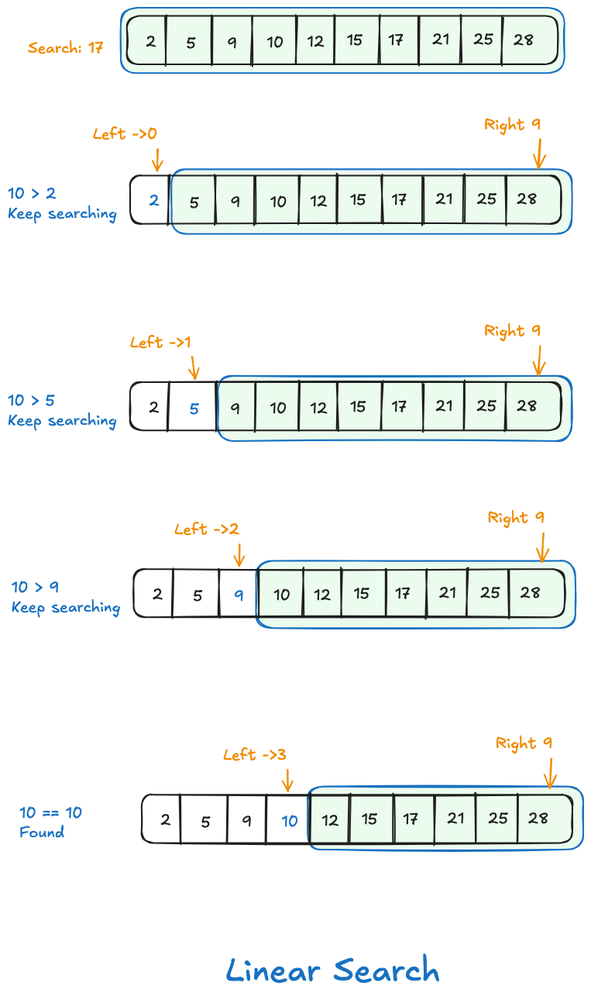

# Linear Search

## 1. What is Linear Search?

**Linear Search** is the simplest searching algorithm. It finds an element by checking each item in a collection, one at a time, until:

- The required element is found.
- All elements have been checked, and the element does not exist.

It starts from the first element and moves sequentially toward the last element.

### Real-world example: Finding a student in a classroom

Imagine a classroom with 30 students sitting in a row. Your teacher asks you to find a student named Rahul.

You don't know where Rahul is sitting, and there is no seating chart.

What would you do?

1. Check the first student.
2. If that is not Rahul, check the second student.
3. Continue checking one student at a time.
4. Stop when you find Rahul or reach the last student.

This is exactly how Linear Search works.

**The important idea:** You don't skip elements. You check them one by one.



## 2. How Does Linear Search Work?

Consider this array:

```java
int[] numbers = {10, 25, 30, 45, 50, 65, 80};
```

Suppose we want to find the number `50`.

Linear Search checks each element from left to right.

### Step-by-step execution

| Step | Index | Current Element | Target | Result |
|---|---:|---:|---:|---|
| 1 | 0 | 10 | 50 | Not found |
| 2 | 1 | 25 | 50 | Not found |
| 3 | 2 | 30 | 50 | Not found |
| 4 | 3 | 45 | 50 | Not found |
| 5 | 4 | 50 | 50 | Found! |

<escape>```text
Array:  [10, 25, 30, 45, 50, 65, 80]
Index:    0   1   2   3   4   5   6
                         |
                      Target
                      Found!
```</escape>

The algorithm stops as soon as it finds the target.

**Total comparisons: 5**

Notice that Linear Search does not need the array to be sorted. It works with both sorted and unsorted data.

## 3. Linear Search Algorithm

### Pseudocode

```text
START

Given an array and a target element

FOR each element in the array:
    IF current element equals target:
        RETURN its index

RETURN -1

END
```

Why return `-1`?

Array indexes start from `0`, so `-1` is commonly used to indicate that an element was not found.

## 4. Java Implementation

### Approach 1: Using a for loop

```java
public class LinearSearch {

    public static int search(int[] arr, int target) {

        for (int i = 0; i < arr.length; i++) {

            if (arr[i] == target) {
                return i;
            }
        }

        return -1;
    }

    public static void main(String[] args) {

        int[] numbers = {10, 25, 30, 45, 50, 65, 80};

        int target = 50;

        int result = search(numbers, target);

        if (result != -1) {
            System.out.println("Element found at index: " + result);
        } else {
            System.out.println("Element not found");
        }
    }
}
```

**Output:**

```text
Element found at index: 4
```

### Understanding the code

- `arr` contains the elements to search.
- `target` is the element we want to find.
- `i` represents the current index.
- `arr[i] == target` checks whether the current element matches the target.
- `return i` returns the index immediately when a match is found.
- `return -1` means the element does not exist in the array.

### Approach 2: Using an enhanced for loop

Java also provides an enhanced `for` loop, which makes iteration easier.

```java
public static boolean contains(int[] arr, int target) {

    for (int number : arr) {

        if (number == target) {
            return true;
        }
    }

    return false;
}
```

This approach returns only whether the element exists, not its index.

**Important:** Use the traditional `for` loop when you need the index.

## 5. Different Cases of Linear Search

Linear Search has three important cases.

### A. Best Case — O(1)

The target is present at the first position.

```java
int[] arr = {10, 20, 30, 40, 50};
int target = 10;
```

Only one comparison is required.

<escape>```text
[10, 20, 30, 40, 50]
 ^
 Found immediately!
```</escape>

Time Complexity: **O(1)**

### B. Average Case — O(n)

The target is somewhere around the middle of the array.

```java
int[] arr = {10, 20, 30, 40, 50};
int target = 30;
```

For a typical successful search with equally likely target positions, approximately half the elements are checked.

For an array of `n` elements:

\[
\text{Average comparisons} = \frac{n+1}{2}
\]

Time Complexity: **O(n)**

### C. Worst Case — O(n)

Two situations can cause the worst case:

1. The target is at the last position.
2. The target does not exist in the array.

```java
int[] arr = {10, 20, 30, 40, 50};
int target = 100;
```

Every element must be checked.

Time Complexity: **O(n)**

### Complexity summary

| Case | Comparisons | Time Complexity |
|---|---:|---|
| Best | 1 | O(1) |
| Average (successful, uniform positions) | (n + 1) / 2 | O(n) |
| Worst | n | O(n) |

## 6. Time and Space Complexity

### Time Complexity

| Operation | Complexity | Explanation |
|---|---|---|
| Best Case | O(1) | Target found at first position |
| Average Case | O(n) | Approximately half the elements checked |
| Worst Case | O(n) | All elements checked |

Here, `n` represents the number of elements in the array.

### Space Complexity

The iterative implementation uses only a few variables:

- `i` — current index
- `target` — element to search
- `result` — returned index

It does not create another array or data structure.

**Auxiliary Space Complexity: O(1)**

The recursive version, if implemented using recursive calls, uses O(n) call-stack space in the worst case.

## 7. Linear Search with Different Data Types

Linear Search is not limited to integers. It can search strings, characters, objects, and other values.

### A. Searching in a String Array

```java
public static int searchString(String[] arr, String target) {

    for (int i = 0; i < arr.length; i++) {

        if (arr[i].equals(target)) {
            return i;
        }
    }

    return -1;
}
```

Example:

```java
String[] names = {"Aman", "Rahul", "Priya", "Sara"};

System.out.println(searchString(names, "Priya"));
```

Output:

```text
2
```

**Important:** Use `.equals()` to compare String content, not `==`.

### B. Searching in an ArrayList

```java
import java.util.ArrayList;
import java.util.List;

public class ArrayListSearch {

    public static int search(List<Integer> numbers, int target) {

        for (int i = 0; i < numbers.size(); i++) {

            if (numbers.get(i) == target) {
                return i;
            }
        }

        return -1;
    }

    public static void main(String[] args) {

        List<Integer> numbers =
                new ArrayList<>(List.of(10, 20, 30, 40, 50));

        System.out.println(search(numbers, 40));
    }
}
```

Output:

```text
3
```

For an ArrayList, indexed access is O(1), so this search takes O(n) time.

For a LinkedList, repeatedly calling `get(i)` can make the implementation O(n²). Prefer iterating through its elements using an iterator or enhanced `for` loop.

## 8. Finding All Occurrences of an Element

What if the target appears more than once?

Example:

```java
int[] arr = {10, 20, 30, 20, 40, 20, 50};
int target = 20;
```

A normal Linear Search returns the first matching index.

But sometimes we need all matching indexes.

### Java implementation

```java
import java.util.ArrayList;
import java.util.List;

public class FindAllOccurrences {

    public static List<Integer> searchAll(int[] arr, int target) {

        List<Integer> indexes = new ArrayList<>();

        for (int i = 0; i < arr.length; i++) {

            if (arr[i] == target) {
                indexes.add(i);
            }
        }

        return indexes;
    }

    public static void main(String[] args) {

        int[] arr = {10, 20, 30, 20, 40, 20, 50};

        System.out.println(searchAll(arr, 20));
    }
}
```

Output:

```text
[1, 3, 5]
```

**Complexity:**

- Time: O(n)
- Auxiliary space: O(k), where `k` is the number of matching elements.

If every element matches, the result list uses O(n) space.

## 9. Linear Search vs Binary Search

Both algorithms are used to find elements, but they work differently.

| Feature | Linear Search | Binary Search |
|---|---|---|
| Searching method | Checks one by one | Divides search range in half |
| Sorted data required? | No | Yes |
| Best Case | O(1) | O(1) |
| Average Case | O(n) | O(log n) |
| Worst Case | O(n) | O(log n) |
| Suitable for | Small or unsorted data | Large sorted data |
| Implementation | Very simple | Slightly more complex |

### Example: Searching in 1,000 elements

Suppose we want to find an element in an array containing 1,000 elements.

- Linear Search may need to check all 1,000 elements.
- Binary Search needs at most 10 comparisons for 1,000 elements (since \(2^{10} = 1024\)).

This is why Binary Search is generally faster for large, sorted arrays.

**Remember:** Binary Search cannot be directly applied to an unsorted array.

## 10. Advantages of Linear Search

1. Very easy to understand and implement.
2. Works with sorted and unsorted data.
3. Does not require additional memory.
4. Works with arrays, lists, and other sequential collections.
5. Useful for small datasets.
6. Can stop immediately when the target is found.

## 11. Disadvantages of Linear Search

1. Slow for large datasets.
2. May need to check every element.
3. Less efficient than Binary Search for large sorted arrays.
4. Repeated searches can become expensive.

## 12. Real-World Applications

Linear Search is useful when data is small, unsorted, or must be inspected sequentially.

Examples:

1. **Finding a name:** Searching for a student's name in an unsorted attendance list.
2. **Finding a product:** Checking products one by one in a small inventory.
3. **Finding a transaction:** Searching through a small list of transaction records.
4. **Checking permissions:** Finding a particular role in a small collection of user roles.
5. **Finding a value:** Checking whether a particular number exists in a list.

## 13. Common Mistakes

### Mistake 1: Using `i <= arr.length`

Incorrect:

```java
for (int i = 0; i <= arr.length; i++) {
    System.out.println(arr[i]);
}
```

Correct:

```java
for (int i = 0; i < arr.length; i++) {
    System.out.println(arr[i]);
}
```

Array indexes range from `0` to `arr.length - 1`.

### Mistake 2: Forgetting to return -1

If the element is not found, return `-1` after the loop.

Otherwise, the method may not return a meaningful result.

### Mistake 3: Using `==` for String comparison

Incorrect:

```java
if (arr[i] == target) {
    return i;
}
```

Correct:

```java
if (arr[i].equals(target)) {
    return i;
}
```

For Strings, `.equals()` compares content. For objects in general, use the appropriate equality implementation.

### Mistake 4: Assuming Linear Search requires sorted data

Linear Search works perfectly fine on unsorted data.

Sorting is not a requirement.

## 14. Interview Questions and Answers

### Q1. What is Linear Search?

Linear Search is a searching algorithm that checks each element sequentially until the target is found or the collection is exhausted.

### Q2. What is the time complexity of Linear Search?

- Best Case: O(1)
- Average Case: O(n)
- Worst Case: O(n)

### Q3. What is the space complexity of Linear Search?

O(1) auxiliary space for the iterative implementation.

### Q4. Does Linear Search require a sorted array?

No. Linear Search works on both sorted and unsorted arrays.

### Q5. What happens if the element is not present?

The algorithm checks all elements and returns `-1` in the implementation provided.

### Q6. Can Linear Search find duplicate elements?

Yes. A normal implementation returns the first occurrence. To find all occurrences, continue searching after finding a match.

### Q7. Why is Linear Search O(n)?

In the worst case, it checks every element. If the input size doubles, the number of checks can also approximately double.

### Q8. When would you choose Linear Search over Binary Search?

Choose Linear Search when:

- The dataset is small.
- The data is unsorted.
- Sorting would cost more than the search itself.
- The collection does not provide efficient random access.
- You only need a simple sequential scan.

### Q9. Is Linear Search an in-place algorithm?

Yes, the iterative implementation is in-place because it uses constant auxiliary space and does not modify the input array.

### Q10. Can Linear Search work with a LinkedList?

Yes. In fact, sequential iteration is a natural way to search a LinkedList. Avoid repeatedly accessing elements by index because that can result in O(n²) time.

## 15. Practice Problems

Try solving these problems using Linear Search.

### Beginner

1. Find whether a number exists in an array.
2. Return the index of a target element.
3. Find the first occurrence of a target.
4. Find the last occurrence of a target.
5. Count how many times a target appears.

### Intermediate

6. Find all indexes of a target element.
7. Find the maximum element in an array.
8. Find the minimum element in an array.
9. Find the second-largest element.
10. Find whether an array contains duplicate elements.

### Challenge

11. Search for a student object by ID.
12. Find the first negative number in an array.
13. Find the first element that occurs only once.
14. Find the missing number in a sequence (using a suitable search or traversal approach).
15. Search for a product by name in a list of product objects.

## 16. Quick Revision

| Concept | Answer |
|---|---|
| Algorithm type | Searching |
| Searching approach | Sequential |
| Sorted array required? | No |
| Best Case | O(1) |
| Average Case | O(n) |
| Worst Case | O(n) |
| Auxiliary Space | O(1) iterative |
| Returns when found | Index or value |
| Returns when not found | Usually -1 |
| Best suited for | Small or unsorted collections |

## Final Takeaway

Linear Search teaches one of the most important ideas in programming: **sometimes the simplest solution is the right solution.**

It may not be the fastest algorithm for large datasets, but it is easy to implement, works without sorting, and forms the foundation for understanding more advanced searching algorithms.

Before learning Binary Search, make sure you can confidently implement Linear Search, explain its complexity, and handle duplicates and missing elements.