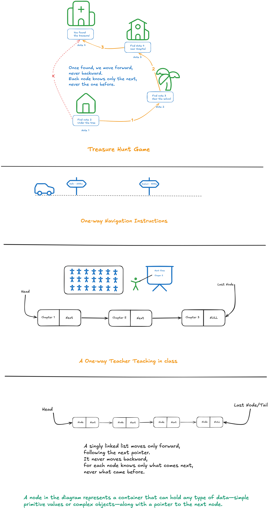
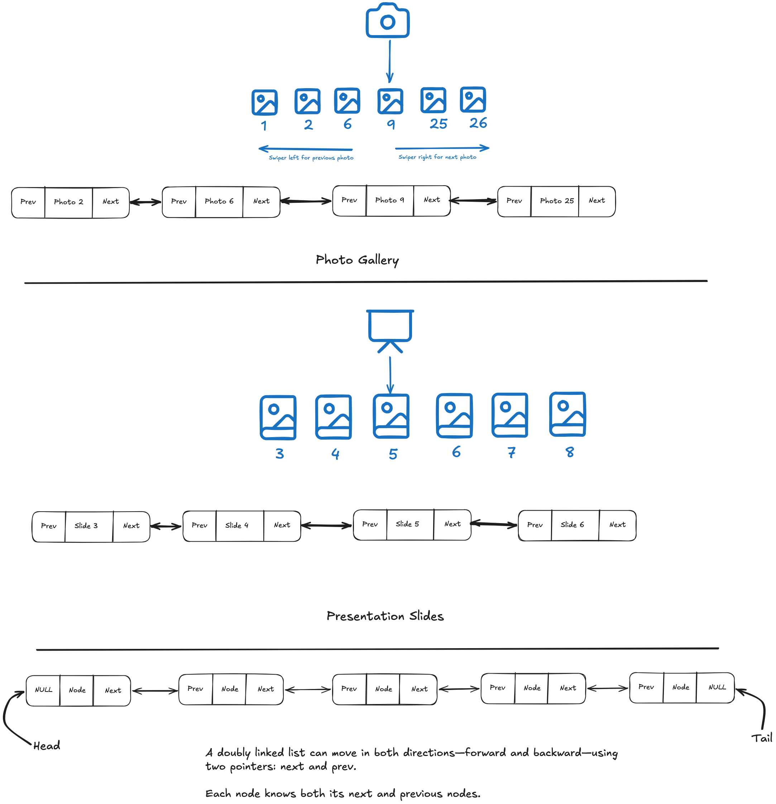

# Linked List

## 1. Introduction

A **Linked List** is a linear data structure used to store a collection of elements called **Nodes**.

Unlike an Array, where elements are stored in continuous memory locations, a Linked List stores elements in separate memory locations and connects them using references (links).

Each node contains two things:

1. **Data:** The actual value stored in the node.
2. **Reference (Link):** The address or reference of another node.

Think of a Linked List like a treasure hunt. Each clue tells you where to find the next clue.

You cannot directly jump to any clue. You must follow the instructions one by one.

There are two commonly used types of Linked Lists:

1. **Singly Linked List:** Each node points only to the next node.
2. **Doubly Linked List:** Each node points to both the previous and the next node.

Let's understand both with real-life examples.

---

# Part 1: Singly Linked List

## 2. What is a Singly Linked List?

A **Singly Linked List** is a linear data structure in which each node contains data and a reference to the next node.

Each node knows only about the next node, not the previous one.

The last node points to `null`, which indicates the end of the Linked List.

### Real-Life Example 1: Treasure Hunt

Imagine you hide four secret notes around a playground.

Each note contains an instruction that tells someone where to find the next note.

- Note 1 says: "Find Note 2 under the tree."
- Note 2 says: "Find Note 3 near the school."
- Note 3 says: "Find Note 4 behind the hospital."
- Note 4 says: "You found the treasure!"

You must follow the instructions in order to reach the treasure.

You cannot directly move backward from Note 3 to Note 2 unless you already know where Note 2 is.

This is exactly how a Singly Linked List works.

### Real-Life Example 2: One-Way Navigation

Imagine following directions on a one-way path.

Each instruction tells you the next location to visit, without storing the previous location.

You can move forward from one location to another, but you cannot automatically return to the previous location using the same instructions.

Similarly, in a Singly Linked List, every node stores a reference only to the next node.

### Real-Life Example 3: A Teacher Teaching a Class

Imagine a sequence of lessons:

- Teacher 1 teaches Mathematics and tells students that the next lesson is Science.
- Teacher 2 teaches Science and tells students that the next lesson is English.
- Teacher 3 teaches English and tells students that the next lesson is History.
- Teacher 4 teaches History and ends the sequence.

Each teacher tells students what comes next, not what came before.

Similarly, each node in a Singly Linked List points to the next node, not the previous node.

### Real-Life Example 4: Online Tutorials

Imagine an online tutorial where each screen contains a link to the next screen.

```text
Screen 1 -> Screen 2 -> Screen 3 -> Screen 4
```

Each screen tells you where to go next, but does not necessarily contain a link to the previous screen.

### Real-Life Example 5: Life and Time

Life itself is another simple analogy.

We move forward in time, from yesterday to today and then tomorrow. We cannot go backward in time.

Similarly, a Singly Linked List naturally allows traversal in one direction.

*This is an analogy to help remember the concept, not a technical property of time.*

## 3. Visual Representation of Singly Linked List



A Singly Linked List looks like this:

```text
HEAD
  |
  v
+------+------+
|  10  |  o---|---->
+------+------+
                 |
                 v
              +------+------+
              |  20  |  o---|---->
              +------+------+
                               |
                               v
                            +------+------+
                            |  30  |  o---|---->
                            +------+------+
                                             |
                                             v
                                          +------+------+
                                          |  40  | null |
                                          +------+------+
```

Each node contains:

```text
+-------------+-------------+
|    DATA     |    NEXT     |
+-------------+-------------+
```

- `DATA`: Stores the actual value.
- `NEXT`: Stores the reference to the next node.

Important terms:

| Term | Meaning |
|---|---|
| Node | Individual element in a Linked List |
| Data | Value stored inside a node |
| Next | Reference to the next node |
| Head | Reference to the first node |
| Tail | Last node in the Linked List |
| Null | Indicates that there is no next node |

The last node points to `null`.

If the Linked List is empty, `head = null`.

## 4. How Does a Singly Linked List Work?

Let's create a Linked List containing:

```text
10 -> 20 -> 30 -> 40 -> null
```

### Step 1: Create the first node

```text
HEAD
  |
  v
+------+------+
|  10  | null |
+------+------+
```

The first node becomes the head.

### Step 2: Add the second node

Create a new node containing `20` and connect the first node to it.

```text
HEAD
  |
  v
+------+------+
|  10  |  o---|---->
+------+------+
                 |
                 v
              +------+------+
              |  20  | null |
              +------+------+
```

### Step 3: Add the third node

Connect the second node to the third node.

```text
HEAD
  |
  v
+------+------+
|  10  |  o---|---->
+------+------+
                 |
                 v
              +------+------+
              |  20  |  o---|---->
              +------+------+
                               |
                               v
                            +------+------+
                            |  30  | null |
                            +------+------+
```

### Step 4: Add the fourth node

```text
HEAD
  |
  v
10 -> 20 -> 30 -> 40 -> null
```

Now we have a Linked List containing four nodes.

To access the fourth node, we must start from the head and follow the next references.

We cannot directly access the fourth node using an index like an Array.

## 5. Implementing a Singly Linked List in Java

Let's implement a Singly Linked List from scratch.

### 5.1 Create a Node

First, we need a class representing an individual node.

```java
class Node {

    int data;
    Node next;

    Node(int data) {
        this.data = data;
        this.next = null;
    }
}
```

Explanation:

- `data` stores the value.
- `next` stores the reference to the next node.
- Initially, `next` is `null` because the new node is not connected to another node.

### 5.2 Create the Linked List

Now let's create a class that manages the nodes.

```java
class SinglyLinkedList {

    Node head;
    Node tail;
    int size;

    // Add node at the end
    public void add(int data) {

        Node newNode = new Node(data);

        if (head == null) {
            head = newNode;
            tail = newNode;
        } else {
            tail.next = newNode;
            tail = newNode;
        }

        size++;
    }

    // Display all elements
    public void display() {

        Node current = head;

        while (current != null) {
            System.out.print(current.data + " -> ");
            current = current.next;
        }

        System.out.println("null");
    }

    // Return the number of elements
    public int size() {
        return size;
    }

    // Check whether the list is empty
    public boolean isEmpty() {
        return head == null;
    }
}
```

### 5.3 Test the Linked List

```java
public class Main {

    public static void main(String[] args) {

        SinglyLinkedList list = new SinglyLinkedList();

        list.add(10);
        list.add(20);
        list.add(30);
        list.add(40);

        list.display();

        System.out.println("Size: " + list.size());
        System.out.println("Empty: " + list.isEmpty());
    }
}
```

Output:

```text
10 -> 20 -> 30 -> 40 -> null

Size: 4
Empty: false
```

## 6. Operations on Singly Linked List

Common operations include:

1. Insert
2. Delete
3. Search
4. Traverse
5. Update
6. Get an element

### 6.1 Insertion

Insertion means adding a new node to the Linked List.

There are three common insertion positions.

#### A. Insert at the Beginning

Suppose we have:

```text
10 -> 20 -> 30 -> null
```

We want to insert `5` at the beginning.

Before:

```text
HEAD
  |
  v
10 -> 20 -> 30 -> null
```

After:

```text
HEAD
  |
  v
5 -> 10 -> 20 -> 30 -> null
```

Java implementation:

```java
public void addFirst(int data) {

    Node newNode = new Node(data);

    newNode.next = head;
    head = newNode;

    if (tail == null) {
        tail = newNode;
    }

    size++;
}
```

Time Complexity: `O(1)`

Why?

We only create a node and update a couple of references. We do not need to traverse the list.

#### B. Insert at the End

Suppose we have:

```text
10 -> 20 -> 30 -> null
```

We want to insert `40` at the end.

After:

```text
10 -> 20 -> 30 -> 40 -> null
```

Java implementation:

```java
public void addLast(int data) {

    Node newNode = new Node(data);

    if (head == null) {
        head = newNode;
        tail = newNode;
    } else {
        tail.next = newNode;
        tail = newNode;
    }

    size++;
}
```

Time Complexity: `O(1)` when we maintain a tail reference.

Without a tail reference, we must traverse the entire list, making it `O(n)`.

#### C. Insert at a Specific Position

Suppose we have:

```text
10 -> 20 -> 40 -> null
```

We want to insert `30` at index `2`.

After:

```text
10 -> 20 -> 30 -> 40 -> null
```

Java implementation:

```java
public void addAt(int index, int data) {

    if (index < 0 || index > size) {
        throw new IndexOutOfBoundsException();
    }

    if (index == 0) {
        addFirst(data);
        return;
    }

    if (index == size) {
        addLast(data);
        return;
    }

    Node newNode = new Node(data);
    Node current = head;

    for (int i = 0; i < index - 1; i++) {
        current = current.next;
    }

    newNode.next = current.next;
    current.next = newNode;

    size++;
}
```

Time Complexity: `O(n)` because we may need to traverse the list to reach the required position.

### 6.2 Deletion

Deletion means removing a node from the Linked List.

#### A. Delete from the Beginning

Before:

```text
HEAD
  |
  v
10 -> 20 -> 30 -> null
```

Delete `10`.

After:

```text
HEAD
  |
  v
20 -> 30 -> null
```

Java implementation:

```java
public int removeFirst() {

    if (head == null) {
        throw new IllegalStateException("List is empty");
    }

    int removedData = head.data;

    head = head.next;

    if (head == null) {
        tail = null;
    }

    size--;

    return removedData;
}
```

Time Complexity: `O(1)`.

#### B. Delete from the End

Before:

```text
10 -> 20 -> 30 -> null
```

Delete `30`.

After:

```text
10 -> 20 -> null
```

Java implementation:

```java
public int removeLast() {

    if (head == null) {
        throw new IllegalStateException("List is empty");
    }

    if (head == tail) {
        int removedData = head.data;

        head = null;
        tail = null;

        size--;

        return removedData;
    }

    Node current = head;

    while (current.next != tail) {
        current = current.next;
    }

    int removedData = tail.data;

    current.next = null;
    tail = current;

    size--;

    return removedData;
}
```

Time Complexity: `O(n)`.

Why?

A Singly Linked List cannot move backward from the tail to its previous node. We must traverse from the head to find the node before the tail.

#### C. Delete from a Specific Position

Before:

```text
10 -> 20 -> 30 -> 40 -> null
```

Delete the element at index `2`.

After:

```text
10 -> 20 -> 40 -> null
```

Java implementation:

```java
public int removeAt(int index) {

    if (index < 0 || index >= size) {
        throw new IndexOutOfBoundsException();
    }

    if (index == 0) {
        return removeFirst();
    }

    Node current = head;

    for (int i = 0; i < index - 1; i++) {
        current = current.next;
    }

    Node removedNode = current.next;

    current.next = removedNode.next;

    if (removedNode == tail) {
        tail = current;
    }

    size--;

    return removedNode.data;
}
```

Time Complexity: `O(n)`.

### 6.3 Searching

Searching means finding whether a particular value exists in the Linked List.

Example:

```text
10 -> 20 -> 30 -> 40 -> null
```

Search for `30`.

We start from the head and compare each node's data with the target.

Java implementation:

```java
public boolean contains(int target) {

    Node current = head;

    while (current != null) {

        if (current.data == target) {
            return true;
        }

        current = current.next;
    }

    return false;
}
```

Time Complexity: `O(n)`.

### 6.4 Traversal

Traversal means visiting every node one by one.

```java
public void display() {

    Node current = head;

    while (current != null) {

        System.out.println(current.data);

        current = current.next;
    }
}
```

Time Complexity: `O(n)`.

### 6.5 Updating a Node

Suppose we want to update the value at a particular index.

```java
public void update(int index, int newValue) {

    if (index < 0 || index >= size) {
        throw new IndexOutOfBoundsException();
    }

    Node current = head;

    for (int i = 0; i < index; i++) {
        current = current.next;
    }

    current.data = newValue;
}
```

Time Complexity: `O(n)`.

### 6.6 Getting an Element by Index

Unlike an Array, a Linked List cannot directly access an element by index.

We must traverse from the head.

```java
public int get(int index) {

    if (index < 0 || index >= size) {
        throw new IndexOutOfBoundsException();
    }

    Node current = head;

    for (int i = 0; i < index; i++) {
        current = current.next;
    }

    return current.data;
}
```

Time Complexity: `O(n)`.

## 7. Complete Singly Linked List Implementation

Here is a complete implementation combining the operations.

```java
class SinglyLinkedList {

    private static class Node {

        int data;
        Node next;

        Node(int data) {
            this.data = data;
        }
    }

    private Node head;
    private Node tail;
    private int size;

    public void addFirst(int data) {

        Node newNode = new Node(data);

        newNode.next = head;
        head = newNode;

        if (tail == null) {
            tail = newNode;
        }

        size++;
    }

    public void addLast(int data) {

        Node newNode = new Node(data);

        if (head == null) {
            head = newNode;
            tail = newNode;
        } else {
            tail.next = newNode;
            tail = newNode;
        }

        size++;
    }

    public void addAt(int index, int data) {

        if (index < 0 || index > size) {
            throw new IndexOutOfBoundsException();
        }

        if (index == 0) {
            addFirst(data);
            return;
        }

        if (index == size) {
            addLast(data);
            return;
        }

        Node current = head;

        for (int i = 0; i < index - 1; i++) {
            current = current.next;
        }

        Node newNode = new Node(data);

        newNode.next = current.next;
        current.next = newNode;

        size++;
    }

    public int removeFirst() {

        if (head == null) {
            throw new IllegalStateException("List is empty");
        }

        int value = head.data;

        head = head.next;

        if (head == null) {
            tail = null;
        }

        size--;

        return value;
    }

    public int removeLast() {

        if (head == null) {
            throw new IllegalStateException("List is empty");
        }

        if (head == tail) {
            int value = head.data;

            head = null;
            tail = null;

            size--;

            return value;
        }

        Node current = head;

        while (current.next != tail) {
            current = current.next;
        }

        int value = tail.data;

        current.next = null;
        tail = current;

        size--;

        return value;
    }

    public int removeAt(int index) {

        if (index < 0 || index >= size) {
            throw new IndexOutOfBoundsException();
        }

        if (index == 0) {
            return removeFirst();
        }

        Node current = head;

        for (int i = 0; i < index - 1; i++) {
            current = current.next;
        }

        Node removed = current.next;

        current.next = removed.next;

        if (removed == tail) {
            tail = current;
        }

        size--;

        return removed.data;
    }

    public boolean contains(int target) {

        Node current = head;

        while (current != null) {

            if (current.data == target) {
                return true;
            }

            current = current.next;
        }

        return false;
    }

    public int get(int index) {

        if (index < 0 || index >= size) {
            throw new IndexOutOfBoundsException();
        }

        Node current = head;

        for (int i = 0; i < index; i++) {
            current = current.next;
        }

        return current.data;
    }

    public void update(int index, int newValue) {

        if (index < 0 || index >= size) {
            throw new IndexOutOfBoundsException();
        }

        Node current = head;

        for (int i = 0; i < index; i++) {
            current = current.next;
        }

        current.data = newValue;
    }

    public int size() {
        return size;
    }

    public boolean isEmpty() {
        return head == null;
    }

    public void display() {

        Node current = head;

        while (current != null) {

            System.out.print(current.data + " -> ");

            current = current.next;
        }

        System.out.println("null");
    }
}
```

Example usage:

```java
public class Main {

    public static void main(String[] args) {

        SinglyLinkedList list = new SinglyLinkedList();

        list.addLast(10);
        list.addLast(20);
        list.addLast(30);

        list.addFirst(5);

        list.display();

        list.addAt(2, 15);

        list.display();

        list.removeAt(2);

        list.display();

        System.out.println("Contains 30: " + list.contains(30));
        System.out.println("Element at index 1: " + list.get(1));
        System.out.println("Size: " + list.size());
    }
}
```

Output:

```text
5 -> 10 -> 20 -> 30 -> null
5 -> 10 -> 15 -> 20 -> 30 -> null
5 -> 10 -> 20 -> 30 -> null

Contains 30: true
Element at index 1: 10
Size: 4
```

## 8. Time and Space Complexity of Singly Linked List

| Operation | Complexity | Explanation |
|---|---|---|
| Access by index | O(n) | Must traverse from head |
| Search | O(n) | May visit every node |
| Insert at beginning | O(1) | Update head |
| Insert at end | O(1) | With tail reference |
| Insert at specific index | O(n) | Must find previous node |
| Delete from beginning | O(1) | Update head |
| Delete from end | O(n) | Must find previous node |
| Delete at specific index | O(n) | Must find previous node |
| Traversal | O(n) | Visit every node |
| Space | O(n) | One node per element |

**Important:** If the tail reference is not maintained, inserting at the end takes `O(n)` instead of `O(1)`.

## 9. Advantages and Disadvantages of Singly Linked List

### Advantages

1. Dynamic size: Can grow and shrink during execution.
2. Efficient insertion at the beginning: Takes `O(1)` time.
3. Efficient deletion at the beginning: Takes `O(1)` time.
4. No requirement for contiguous memory locations.
5. Useful for implementing stacks and other data structures.

### Disadvantages

1. Only forward traversal is possible.
2. Cannot directly access elements using an index.
3. Searching takes `O(n)` time.
4. Deleting the last node takes `O(n)` time.
5. Each node requires extra memory for a reference.

## 10. Applications of Singly Linked List

- Implementing stacks.
- Implementing hash table chaining.
- Graph adjacency lists.
- Simple task sequences.
- Forward-only navigation.
- Memory management structures.
- Representing polynomial expressions.

---

# Part 2: Doubly Linked List

## 11. What is a Doubly Linked List?

A **Doubly Linked List** is a linear data structure in which each node contains three things:

1. Data
2. Reference to the previous node
3. Reference to the next node

Unlike a Singly Linked List, a Doubly Linked List supports traversal in both directions.

We can move forward as well as backward.

### Why Do We Need a Doubly Linked List?

A Singly Linked List works well when we only need to move forward.

But sometimes we need to move both forward and backward.

For example:

- Viewing the next and previous photos.
- Moving between browser history pages.
- Going to the next or previous presentation slide.
- Undoing and redoing changes in an editor.
- Moving to the next or previous song in a music player.

For these situations, a Doubly Linked List is useful.

## 12. Real-Life Examples of Doubly Linked List

### Real-Life Example 1: Photo Gallery

Imagine you are viewing photos on your phone.

You have four photos:

```text
Photo 1 <-> Photo 2 <-> Photo 3 <-> Photo 4
```

- Photo 1 knows Photo 2 is next.
- Photo 2 knows Photo 1 is previous and Photo 3 is next.
- Photo 3 knows Photo 2 is previous and Photo 4 is next.
- Photo 4 knows Photo 3 is previous.

You can move forward to the next photo or backward to the previous photo.

Every photo has a reference to both the previous photo and the next photo.

This is exactly how a Doubly Linked List works.

### Real-Life Example 2: Browser Navigation History

Imagine visiting these webpages:

```text
Google <-> YouTube <-> Wikipedia <-> GitHub
```

You can:

- Click Back to visit the previous webpage.
- Click Forward to visit the next webpage.

The navigation history behaves similarly to a Doubly Linked List.

A browser's actual history implementation can be more complex, but this is a useful conceptual example.

### Real-Life Example 3: Undo and Redo

Imagine editing a document.

You perform these operations:

```text
State 1 <-> State 2 <-> State 3 <-> State 4
```

- State 1: Original document.
- State 2: Added a heading.
- State 3: Added a paragraph.
- State 4: Changed the font.

You can undo to return to an earlier state or redo to move forward again.

This is similar to navigating a Doubly Linked List.

Real editors may use other structures or specialized history mechanisms, but the concept is similar.

### Real-Life Example 4: Presentation Slides

Imagine a presentation containing four slides.

```text
Slide 1 <-> Slide 2 <-> Slide 3 <-> Slide 4
```

You can navigate:

- Next Slide
- Previous Slide

Each slide can be thought of as having a reference to the previous slide and the next slide.

### Real-Life Example 5: Music Player

Imagine a music playlist:

```text
Song 1 <-> Song 2 <-> Song 3 <-> Song 4
```

You can:

- Play the next song.
- Play the previous song.

This is another useful example of two-way navigation.

## 13. Visual Representation of Doubly Linked List



A Doubly Linked List looks like this:

```text
              HEAD
                |
                v
null <-> 10 <-> 20 <-> 30 <-> 40 <-> null
                                      ^
                                      |
                                     TAIL
```

Each node contains three parts:

```text
+----------+----------+----------+
|   PREV   |   DATA   |   NEXT   |
+----------+----------+----------+
```

- `PREV`: Reference to the previous node.
- `DATA`: Actual value.
- `NEXT`: Reference to the next node.

Important observations:

1. The first node's `prev` is `null`.
2. The last node's `next` is `null`.
3. Every middle node has both previous and next references.
4. We can traverse from head to tail.
5. We can also traverse from tail to head.

## 14. How Does a Doubly Linked List Work?

Let's create a Doubly Linked List:

```text
10 <-> 20 <-> 30 <-> 40
```

### Step 1: Create the first node

```text
HEAD
  |
  v
null <- 10 -> null
```

Initially, there is only one node.

Its previous and next references are both `null`.

### Step 2: Add the second node

```text
null <- 10 <-> 20 -> null
```

Now:

- Node `10` points to node `20`.
- Node `20` points back to node `10`.

### Step 3: Add the third node

```text
null <- 10 <-> 20 <-> 30 -> null
```

Now we can move from `10` to `20` to `30`, or from `30` to `20` to `10`.

### Step 4: Add the fourth node

```text
null <- 10 <-> 20 <-> 30 <-> 40 -> null
```

The list is complete.

## 15. Implementing a Doubly Linked List in Java

### 15.1 Create a Node

```java
class Node {

    int data;

    Node prev;
    Node next;

    Node(int data) {
        this.data = data;
    }
}
```

Explanation:

- `data` stores the value.
- `prev` points to the previous node.
- `next` points to the next node.

### 15.2 Create the Doubly Linked List

```java
class DoublyLinkedList {

    Node head;
    Node tail;
    int size;

    // Add at the end
    public void add(int data) {

        Node newNode = new Node(data);

        if (head == null) {
            head = newNode;
            tail = newNode;
        } else {

            tail.next = newNode;
            newNode.prev = tail;

            tail = newNode;
        }

        size++;
    }

    // Display from beginning to end
    public void displayForward() {

        Node current = head;

        while (current != null) {

            System.out.print(current.data + " <-> ");

            current = current.next;
        }

        System.out.println("null");
    }

    // Display from end to beginning
    public void displayBackward() {

        Node current = tail;

        while (current != null) {

            System.out.print(current.data + " <-> ");

            current = current.prev;
        }

        System.out.println("null");
    }

    public int size() {
        return size;
    }

    public boolean isEmpty() {
        return head == null;
    }
}
```

### 15.3 Test the Doubly Linked List

```java
public class Main {

    public static void main(String[] args) {

        DoublyLinkedList list = new DoublyLinkedList();

        list.add(10);
        list.add(20);
        list.add(30);
        list.add(40);

        System.out.println("Forward:");

        list.displayForward();

        System.out.println("Backward:");

        list.displayBackward();
    }
}
```

Output:

```text
Forward:
10 <-> 20 <-> 30 <-> 40 <-> null

Backward:
40 <-> 30 <-> 20 <-> 10 <-> null
```

## 16. Operations on Doubly Linked List

### 16.1 Insertion

There are three common insertion positions.

#### A. Insert at the Beginning

Before:

```text
null <- 10 <-> 20 <-> 30 -> null
```

Insert `5`.

After:

```text
null <- 5 <-> 10 <-> 20 <-> 30 -> null
```

Java implementation:

```java
public void addFirst(int data) {

    Node newNode = new Node(data);

    if (head == null) {
        head = newNode;
        tail = newNode;
    } else {

        newNode.next = head;
        head.prev = newNode;

        head = newNode;
    }

    size++;
}
```

Time Complexity: `O(1)`.

#### B. Insert at the End

Before:

```text
null <- 10 <-> 20 <-> 30 -> null
```

Insert `40`.

After:

```text
null <- 10 <-> 20 <-> 30 <-> 40 -> null
```

Java implementation:

```java
public void addLast(int data) {

    Node newNode = new Node(data);

    if (tail == null) {
        head = newNode;
        tail = newNode;
    } else {

        tail.next = newNode;
        newNode.prev = tail;

        tail = newNode;
    }

    size++;
}
```

Time Complexity: `O(1)` when we maintain a tail reference.

#### C. Insert at a Specific Position

Before:

```text
10 <-> 20 <-> 40
```

Insert `30` at index `2`.

After:

```text
10 <-> 20 <-> 30 <-> 40
```

Java implementation:

```java
public void addAt(int index, int data) {

    if (index < 0 || index > size) {
        throw new IndexOutOfBoundsException();
    }

    if (index == 0) {
        addFirst(data);
        return;
    }

    if (index == size) {
        addLast(data);
        return;
    }

    Node current = getNode(index);

    Node previous = current.prev;

    Node newNode = new Node(data);

    newNode.prev = previous;
    newNode.next = current;

    previous.next = newNode;
    current.prev = newNode;

    size++;
}
```

We also need a helper method:

```java
private Node getNode(int index) {

    if (index < size / 2) {

        Node current = head;

        for (int i = 0; i < index; i++) {
            current = current.next;
        }

        return current;

    } else {

        Node current = tail;

        for (int i = size - 1; i > index; i--) {
            current = current.prev;
        }

        return current;
    }
}
```

This helper starts from the closer end of the list.

Time Complexity: `O(n)` in the worst case, approximately `O(n/2)` traversal when starting from the nearer end.

### 16.2 Deletion

#### A. Delete from the Beginning

Before:

```text
null <- 10 <-> 20 <-> 30 -> null
```

Delete `10`.

After:

```text
null <- 20 <-> 30 -> null
```

Java implementation:

```java
public int removeFirst() {

    if (head == null) {
        throw new IllegalStateException("List is empty");
    }

    int value = head.data;

    head = head.next;

    if (head == null) {
        tail = null;
    } else {
        head.prev = null;
    }

    size--;

    return value;
}
```

Time Complexity: `O(1)`.

#### B. Delete from the End

Before:

```text
null <- 10 <-> 20 <-> 30 -> null
```

Delete `30`.

After:

```text
null <- 10 <-> 20 -> null
```

Java implementation:

```java
public int removeLast() {

    if (tail == null) {
        throw new IllegalStateException("List is empty");
    }

    int value = tail.data;

    tail = tail.prev;

    if (tail == null) {
        head = null;
    } else {
        tail.next = null;
    }

    size--;

    return value;
}
```

Time Complexity: `O(1)`.

Unlike a Singly Linked List, we do not need to traverse from the head because the tail's `prev` reference directly points to the previous node.

#### C. Delete from a Specific Position

Before:

```text
10 <-> 20 <-> 30 <-> 40
```

Delete the node at index `2`.

After:

```text
10 <-> 20 <-> 40
```

Java implementation:

```java
public int removeAt(int index) {

    if (index < 0 || index >= size) {
        throw new IndexOutOfBoundsException();
    }

    if (index == 0) {
        return removeFirst();
    }

    if (index == size - 1) {
        return removeLast();
    }

    Node current = getNode(index);

    Node previous = current.prev;
    Node next = current.next;

    previous.next = next;
    next.prev = previous;

    size--;

    return current.data;
}
```

Time Complexity: `O(n)` to locate the node. Once the node is known, unlinking it takes `O(1)`.

### 16.3 Forward Traversal

We start from the head and follow the `next` reference.

```java
public void displayForward() {

    Node current = head;

    while (current != null) {

        System.out.print(current.data + " <-> ");

        current = current.next;
    }

    System.out.println("null");
}
```

### 16.4 Backward Traversal

We start from the tail and follow the `prev` reference.

```java
public void displayBackward() {

    Node current = tail;

    while (current != null) {

        System.out.print(current.data + " <-> ");

        current = current.prev;
    }

    System.out.println("null");
}
```

Both traversal operations take `O(n)` time.

### 16.5 Searching

```java
public boolean contains(int target) {

    Node current = head;

    while (current != null) {

        if (current.data == target) {
            return true;
        }

        current = current.next;
    }

    return false;
}
```

Time Complexity: `O(n)`.

### 16.6 Getting an Element by Index

```java
public int get(int index) {

    if (index < 0 || index >= size) {
        throw new IndexOutOfBoundsException();
    }

    return getNode(index).data;
}
```

Time Complexity: `O(n)` in the worst case.

Because we have both `head` and `tail`, we can start from whichever end is closer.

## 17. Complete Doubly Linked List Implementation

```java
class DoublyLinkedList {

    private static class Node {

        int data;
        Node prev;
        Node next;

        Node(int data) {
            this.data = data;
        }
    }

    private Node head;
    private Node tail;
    private int size;

    public void addFirst(int data) {

        Node newNode = new Node(data);

        if (head == null) {
            head = newNode;
            tail = newNode;
        } else {

            newNode.next = head;
            head.prev = newNode;

            head = newNode;
        }

        size++;
    }

    public void addLast(int data) {

        Node newNode = new Node(data);

        if (tail == null) {
            head = newNode;
            tail = newNode;
        } else {

            tail.next = newNode;
            newNode.prev = tail;

            tail = newNode;
        }

        size++;
    }

    public void addAt(int index, int data) {

        if (index < 0 || index > size) {
            throw new IndexOutOfBoundsException();
        }

        if (index == 0) {
            addFirst(data);
            return;
        }

        if (index == size) {
            addLast(data);
            return;
        }

        Node current = getNode(index);
        Node previous = current.prev;

        Node newNode = new Node(data);

        newNode.prev = previous;
        newNode.next = current;

        previous.next = newNode;
        current.prev = newNode;

        size++;
    }

    public int removeFirst() {

        if (head == null) {
            throw new IllegalStateException("List is empty");
        }

        int value = head.data;

        head = head.next;

        if (head == null) {
            tail = null;
        } else {
            head.prev = null;
        }

        size--;

        return value;
    }

    public int removeLast() {

        if (tail == null) {
            throw new IllegalStateException("List is empty");
        }

        int value = tail.data;

        tail = tail.prev;

        if (tail == null) {
            head = null;
        } else {
            tail.next = null;
        }

        size--;

        return value;
    }

    public int removeAt(int index) {

        if (index < 0 || index >= size) {
            throw new IndexOutOfBoundsException();
        }

        if (index == 0) {
            return removeFirst();
        }

        if (index == size - 1) {
            return removeLast();
        }

        Node current = getNode(index);

        current.prev.next = current.next;
        current.next.prev = current.prev;

        size--;

        return current.data;
    }

    private Node getNode(int index) {

        if (index < size / 2) {

            Node current = head;

            for (int i = 0; i < index; i++) {
                current = current.next;
            }

            return current;

        } else {

            Node current = tail;

            for (int i = size - 1; i > index; i--) {
                current = current.prev;
            }

            return current;
        }
    }

    public boolean contains(int target) {

        Node current = head;

        while (current != null) {

            if (current.data == target) {
                return true;
            }

            current = current.next;
        }

        return false;
    }

    public int get(int index) {

        if (index < 0 || index >= size) {
            throw new IndexOutOfBoundsException();
        }

        return getNode(index).data;
    }

    public int size() {
        return size;
    }

    public boolean isEmpty() {
        return head == null;
    }

    public void displayForward() {

        Node current = head;

        while (current != null) {

            System.out.print(current.data + " <-> ");

            current = current.next;
        }

        System.out.println("null");
    }

    public void displayBackward() {

        Node current = tail;

        while (current != null) {

            System.out.print(current.data + " <-> ");

            current = current.prev;
        }

        System.out.println("null");
    }
}
```

Example usage:

```java
public class Main {

    public static void main(String[] args) {

        DoublyLinkedList list = new DoublyLinkedList();

        list.addLast(10);
        list.addLast(20);
        list.addLast(30);

        list.addFirst(5);

        System.out.println("Forward:");
        list.displayForward();

        System.out.println("Backward:");
        list.displayBackward();

        list.addAt(2, 15);

        System.out.println("After insertion:");
        list.displayForward();

        list.removeAt(2);

        System.out.println("After deletion:");
        list.displayForward();

        System.out.println("Contains 30: " + list.contains(30));
        System.out.println("Size: " + list.size());
    }
}
```

Output:

```text
Forward:
5 <-> 10 <-> 20 <-> 30 <-> null

Backward:
30 <-> 20 <-> 10 <-> 5 <-> null

After insertion:
5 <-> 10 <-> 15 <-> 20 <-> 30 <-> null

After deletion:
5 <-> 10 <-> 20 <-> 30 <-> null

Contains 30: true
Size: 4
```

## 18. Time and Space Complexity of Doubly Linked List

| Operation | Complexity | Explanation |
|---|---|---|
| Access by index | O(n) | Traverse from a suitable end |
| Search | O(n) | May visit every node |
| Insert at beginning | O(1) | Update head and references |
| Insert at end | O(1) | Update tail and references |
| Insert at specific index | O(n) | Locate the insertion position |
| Delete from beginning | O(1) | Update head |
| Delete from end | O(1) | Update tail |
| Delete at specific index | O(n) | Locate the node first |
| Forward traversal | O(n) | Follow next references |
| Backward traversal | O(n) | Follow previous references |
| Space | O(n) | Each node stores two references |

An important advantage is that deleting the last node takes `O(1)` when we maintain a tail reference.

## 19. Advantages and Disadvantages of Doubly Linked List

### Advantages

1. Supports forward and backward traversal.
2. Insertion at the beginning takes `O(1)`.
3. Insertion at the end takes `O(1)` with a tail reference.
4. Deletion at the end takes `O(1)` with a tail reference.
5. Once a node is known, it can be removed in `O(1)` time.
6. Useful for navigation-based applications.

### Disadvantages

1. Requires extra memory for the previous reference.
2. More complex than a Singly Linked List.
3. Insertion requires updating more references.
4. Incorrect reference updates can break the list.
5. Searching still takes `O(n)` time.

## 20. Applications of Doubly Linked List

- Browser navigation history.
- Music and video players.
- Photo galleries.
- Undo and redo functionality.
- Presentation slide navigation.
- Deques (Double-Ended Queues).
- LRU Cache implementation.
- Navigating between pages or records.

---

# Part 3: Singly vs Doubly Linked List

## 21. Difference Between Singly and Doubly Linked List

| Feature | Singly Linked List | Doubly Linked List |
|---|---|---|
| References per node | One (`next`) | Two (`prev`, `next`) |
| Traversal | Forward only | Forward and backward |
| Memory usage | Lower | Higher |
| Insert at beginning | O(1) | O(1) |
| Insert at end | O(1) with tail | O(1) with tail |
| Delete from beginning | O(1) | O(1) |
| Delete from end | O(n) | O(1) with tail |
| Reverse traversal | Not directly possible | Possible |
| Implementation | Simpler | More complex |
| Best use case | Forward-only navigation | Two-way navigation |

### Visual Comparison

**Singly Linked List**

```text
HEAD
  |
  v
10 -> 20 -> 30 -> 40 -> null

Direction: Forward only
```

**Doubly Linked List**

```text
null <- 10 <-> 20 <-> 30 <-> 40 -> null

Direction: Forward and backward
```

### Which One Should We Choose?

Choose a Singly Linked List when:

- You only need forward traversal.
- Memory usage is important.
- You want a simpler implementation.
- You mainly insert or delete at the beginning.

Choose a Doubly Linked List when:

- You need forward and backward traversal.
- You need efficient removal from both ends.
- You frequently navigate between previous and next elements.
- You are implementing an LRU Cache or a Deque.

---

# Part 4: Important Linked List Concepts

## 22. Array vs Linked List

A common interview question is: What is the difference between an Array and a Linked List?

| Feature | Array | Linked List |
|---|---|---|
| Memory | Contiguous logical storage | Nodes can be located separately |
| Size | Fixed for a Java array | Dynamic |
| Access by index | O(1) | O(n) |
| Search | O(n) without sorting | O(n) |
| Insert at beginning | O(n) | O(1) |
| Delete at beginning | O(n) | O(1) |
| Extra memory | Usually no link per element | Stores references |
| Cache locality | Usually better | Usually poorer |

### Why Is Array Access O(1)?

An Array stores elements in indexed positions.

For example:

```java
int[] numbers = {10, 20, 30, 40};

System.out.println(numbers[2]);
```

Java can directly access the element at index `2`.

### Why Is Linked List Access O(n)?

A Linked List does not have direct indexed access.

To get the third element, we must start from the head and follow the references:

```text
10 -> 20 -> 30 -> 40
          ^
          |
       Required
```

We must visit the first and second nodes before reaching the third node.

## 23. Reverse a Singly Linked List

This is one of the most common Linked List interview problems.

Given:

```text
10 -> 20 -> 30 -> 40 -> null
```

Reverse it:

```text
40 -> 30 -> 20 -> 10 -> null
```

We can solve this using three references:

- `prev`: Previous node.
- `current`: Current node.
- `next`: Next node.

Java implementation:

```java
public void reverse() {

    Node prev = null;
    Node current = head;

    tail = head;

    while (current != null) {

        Node next = current.next;

        current.next = prev;

        prev = current;

        current = next;
    }

    head = prev;
}
```

### Step-by-Step Explanation

Initially:

```text
prev = null
current = 10
```

Save the next node before changing the link.

```text
next = 20
```

Reverse the current node's link:

```text
10 -> null
```

Move forward:

```text
prev = 10
current = 20
```

Continue the same process.

Final result:

```text
40 -> 30 -> 20 -> 10 -> null
```

Complexity:

- Time: `O(n)`
- Space: `O(1)`

This is an in-place reversal because we do not create another Linked List.

## 24. Find the Middle Node of a Linked List

Another very common interview question.

Given:

```text
10 -> 20 -> 30 -> 40 -> 50 -> null
```

Find the middle element.

A common solution uses two pointers:

- Slow pointer moves one step at a time.
- Fast pointer moves two steps at a time.

When the fast pointer reaches the end, the slow pointer is at the middle.

Java implementation:

```java
public Node findMiddle() {

    Node slow = head;
    Node fast = head;

    while (fast != null && fast.next != null) {

        slow = slow.next;
        fast = fast.next.next;
    }

    return slow;
}
```

For an even number of nodes, this implementation returns the second middle node.

Complexity:

- Time: `O(n)`
- Space: `O(1)`

## 25. Detect a Cycle in a Linked List

A cycle occurs when a node points back to an earlier node instead of pointing to `null`.

Example:

```text
10 -> 20 -> 30 -> 40
      ^           |
      |___________|
```

The list never reaches `null`.

We can detect this using Floyd's Cycle Detection Algorithm, also called the Tortoise and Hare Algorithm.

Java implementation:

```java
public boolean hasCycle(Node head) {

    Node slow = head;
    Node fast = head;

    while (fast != null && fast.next != null) {

        slow = slow.next;
        fast = fast.next.next;

        if (slow == fast) {
            return true;
        }
    }

    return false;
}
```

If the slow and fast pointers meet, a cycle exists.

Complexity:

- Time: `O(n)`
- Space: `O(1)`

## 26. Merge Two Sorted Linked Lists

Given two sorted Linked Lists:

```text
List 1: 10 -> 30 -> 50

List 2: 20 -> 40 -> 60
```

Merge them into:

```text
10 -> 20 -> 30 -> 40 -> 50 -> 60
```

Java implementation:

```java
public Node mergeTwoLists(Node list1, Node list2) {

    Node dummy = new Node(0);

    Node current = dummy;

    while (list1 != null && list2 != null) {

        if (list1.data <= list2.data) {

            current.next = list1;
            list1 = list1.next;

        } else {

            current.next = list2;
            list2 = list2.next;
        }

        current = current.next;
    }

    if (list1 != null) {
        current.next = list1;
    }

    if (list2 != null) {
        current.next = list2;
    }

    return dummy.next;
}
```

Complexity:

- Time: `O(n + m)`
- Auxiliary space: `O(1)` when reusing the existing nodes.

Here, `n` and `m` represent the lengths of the two lists.

---

# Part 5: Java Collection Framework

## 27. LinkedList in Java

Java already provides a built-in `LinkedList` class.

It is available in:

```java
import java.util.LinkedList;
```

Java's `LinkedList` is implemented as a **Doubly Linked List**.

Example:

```java
import java.util.LinkedList;

public class Main {

    public static void main(String[] args) {

        LinkedList<Integer> list = new LinkedList<>();

        list.add(10);
        list.add(20);
        list.add(30);

        list.addFirst(5);
        list.addLast(40);

        System.out.println(list);

        list.removeFirst();
        list.removeLast();

        System.out.println(list);
    }
}
```

Output:

```text
[5, 10, 20, 30, 40]

[10, 20, 30]
```

### Common Java LinkedList Methods

| Method | Description |
|---|---|
| `add(element)` | Add an element at the end |
| `addFirst(element)` | Add at the beginning |
| `addLast(element)` | Add at the end |
| `get(index)` | Get an element by index |
| `getFirst()` | Get the first element |
| `getLast()` | Get the last element |
| `remove()` | Remove the first element |
| `removeFirst()` | Remove the first element |
| `removeLast()` | Remove the last element |
| `contains(element)` | Check whether an element exists |
| `size()` | Return the number of elements |
| `isEmpty()` | Check whether the list is empty |
| `clear()` | Remove all elements |
| `indexOf(element)` | Find the first matching index |
| `lastIndexOf(element)` | Find the last matching index |

### LinkedList as a Queue

Java's `LinkedList` also implements the `Queue` interface.

```java
import java.util.LinkedList;
import java.util.Queue;

public class Main {

    public static void main(String[] args) {

        Queue<Integer> queue = new LinkedList<>();

        queue.offer(10);
        queue.offer(20);
        queue.offer(30);

        System.out.println(queue.peek()); // 10

        System.out.println(queue.poll()); // 10
        System.out.println(queue);        // [20, 30]
    }
}
```

### LinkedList as a Deque

Java's `LinkedList` also implements the `Deque` interface.

This allows insertion and removal at both ends.

```java
import java.util.Deque;
import java.util.LinkedList;

public class Main {

    public static void main(String[] args) {

        Deque<Integer> deque = new LinkedList<>();

        deque.addFirst(10);
        deque.addLast(20);

        System.out.println(deque);

        deque.removeFirst();
        deque.removeLast();
    }
}
```

**Important:** Although Java's `LinkedList` supports many operations, it is not automatically the best choice for every situation. For example, `ArrayList` is usually a better choice for frequent indexed access.

---

# Part 6: Interview Questions

## 28. Common Linked List Interview Questions

**Q1. What is a Linked List?**

A Linked List is a linear data structure where elements are stored in nodes. Each node contains data and one or more references connecting it to other nodes.

**Q2. What is the difference between an Array and a Linked List?**

An Array stores elements in indexed positions and provides O(1) access by index. A Linked List connects individual nodes using references and generally requires O(n) time to access an element by index.

**Q3. What is the difference between Singly and Doubly Linked List?**

A Singly Linked List has only a `next` reference, while a Doubly Linked List has both `prev` and `next` references.

**Q4. Why is insertion at the beginning O(1)?**

Because we only need to create a new node, point it to the current head, and update the head reference.

**Q5. Why is searching O(n)?**

Because we may need to visit every node to find the required element.

**Q6. Why is accessing an element by index O(n)?**

Because a Linked List does not provide direct indexed access. We must traverse from one end to reach the required node.

**Q7. Why is deleting the last element O(n) in a Singly Linked List?**

Even if we have a tail reference, we cannot directly access the previous node. We must traverse from the head to find it.

**Q8. Why is deleting the last element O(1) in a Doubly Linked List?**

Because the tail node has a `prev` reference that directly points to the previous node.

**Q9. Can a Linked List contain duplicate elements?**

Yes. A Linked List can contain duplicate values.

**Q10. Can a Linked List contain null values?**

Yes, a custom Linked List can store null as data if its implementation allows it. Java's `LinkedList` also permits null elements.

**Q11. What happens if the head is null?**

The Linked List is empty.

**Q12. What is a circular Linked List?**

A Circular Linked List is a Linked List in which the last node points back to the first node instead of pointing to `null`.

**Q13. What is the difference between a normal and circular Linked List?**

In a normal Linked List, the last node points to `null`. In a Circular Linked List, the last node points back to the first node.

**Q14. Is Java's LinkedList a Singly or Doubly Linked List?**

Java's built-in `LinkedList` is a Doubly Linked List.

**Q15. Is Java's LinkedList thread-safe?**

No. Java's standard `LinkedList` is not synchronized and is not thread-safe by default.

**Q16. Can we implement a Stack using a Linked List?**

Yes. We can use the head as the top of the Stack. Push and pop can both take O(1) time.

**Q17. Can we implement a Queue using a Linked List?**

Yes. Maintain head and tail references. Insert at the tail and remove from the head, both in O(1) time.

**Q18. How do you reverse a Linked List?**

Use three references: `prev`, `current`, and `next`. Reverse each node's `next` reference while traversing the list.

**Q19. How do you detect a cycle in a Linked List?**

Use Floyd's Cycle Detection Algorithm with slow and fast pointers.

**Q20. What is the time complexity of reversing a Linked List?**

O(n) time and O(1) auxiliary space for iterative reversal.

---

# Part 7: Coding Problems to Practice

## 29. Beginner Level

1. Create a Singly Linked List.
2. Insert a node at the beginning.
3. Insert a node at the end.
4. Delete the first node.
5. Delete the last node.
6. Search for an element.
7. Find the length of a Linked List.
8. Print all elements in reverse order using recursion.
9. Find the middle node.
10. Reverse a Linked List.

## 30. Intermediate Level

11. Detect a cycle in a Linked List.
12. Find the starting node of a cycle.
13. Remove duplicates from a sorted Linked List.
14. Remove duplicates from an unsorted Linked List.
15. Merge two sorted Linked Lists.
16. Find the Nth node from the end.
17. Check whether a Linked List is a palindrome.
18. Delete a node when only that node is provided.
19. Find the intersection point of two Linked Lists.
20. Add two numbers represented by Linked Lists.

## 31. Advanced Level

21. Reverse a Linked List in groups of K.
22. Flatten a multilevel Doubly Linked List.
23. Copy a Linked List with random pointers.
24. Rotate a Linked List.
25. Sort a Linked List using Merge Sort.
26. Implement an LRU Cache using a HashMap and Doubly Linked List.
27. Implement a browser history navigation system.
28. Implement a music player playlist with next and previous navigation.
29. Find the intersection of two linked lists without extra space.
30. Reverse a Doubly Linked List.

---

# Part 8: Quick Revision

## 32. Singly Linked List Cheat Sheet

| Concept | Remember |
|---|---|
| Node structure | Data + Next |
| First node | Head |
| Last node | Next = null |
| Traversal | Forward only |
| Insert at beginning | O(1) |
| Insert at end | O(1) with tail |
| Delete from beginning | O(1) |
| Delete from end | O(n) |
| Search | O(n) |
| Access by index | O(n) |
| Space | O(n) |

## 33. Doubly Linked List Cheat Sheet

| Concept | Remember |
|---|---|
| Node structure | Prev + Data + Next |
| First node | Prev = null |
| Last node | Next = null |
| Traversal | Forward and backward |
| Insert at beginning | O(1) |
| Insert at end | O(1) with tail |
| Delete from beginning | O(1) |
| Delete from end | O(1) with tail |
| Search | O(n) |
| Access by index | O(n) |
| Space | O(n) |

## 34. Final Takeaway

Think of Linked Lists using these simple examples:

**Singly Linked List:**

- Treasure hunt clues.
- One-way navigation.
- A sequence of lessons.
- Forward-only tutorial screens.
- Moving forward through time.

Each node tells you where to go next.

**Doubly Linked List:**

- Photo gallery.
- Browser navigation history.
- Undo and redo.
- Presentation slides.
- Music player playlist.

Each node knows both where it came from and where it should go next.

The most important difference is:

```text
Singly Linked List:

10 -> 20 -> 30 -> 40 -> null

Only forward.


Doubly Linked List:

null <- 10 <-> 20 <-> 30 <-> 40 -> null

Forward and backward.
```

**Remember:** A Singly Linked List stores one link per node, while a Doubly Linked List stores two links per node. Choose the structure based on whether your application needs one-way or two-way navigation.